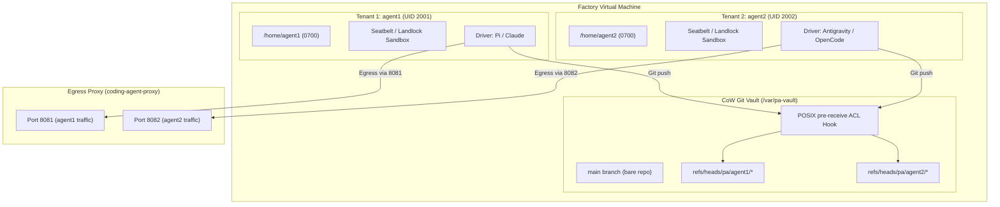

# Multi-Agent Architecture: PA-Container 2.0

PA-Container 2.0 provides native multi-tenant agent execution inside a shared Factory VM. Rather than running a single container per agent, the Factory VM provisions dedicated POSIX user accounts, independent kernel sandboxes, isolated Git branches, and distinct proxy listening ports for each agent.

---

## 1. Multi-Tenant Agent Security Model



### Core Tenancy Principles

- **POSIX User Separation:**
    - Every agent runs under a unique POSIX UID ($\text{UID} \ge 2001$, e.g., 2001 for `agent1`, 2002 for `agent2`).
    - Home directories are locked down (`0700`), preventing cross-agent filesystem inspection.
- **Kernel-Level Sandboxing:**
    - Linux: Landlock ABI v4+ restricts filesystem traversal and network syscalls; Bubblewrap isolates namespaces.
    - macOS: Apple Seatbelt (`.sb`) profiles enforce read-only system roots and Metal GPU acceleration access.
- **Git Branch Namespacing:**
    - Agent Git operations interact with the local `/var/pa-vault` bare repository.
    - Agents may only push to their assigned branch namespace: `refs/heads/pa/$AGENT_ID/*`.
    - Cross-agent overwrites or pushes to `main` are rejected by the pre-receive hook.
- **Port-Based Proxy Attribution:**
    - `agent1` traffic routes through port `8081`; `agent2` routes through port `8082`.
    - Outbound audit logs (`flows-agent1.jsonl`, `flows-agent2.jsonl`) maintain forensic isolation.

---

## 2. Supported Agent Drivers

| Agent Identifier | Driver Engine | Binary Name | Default Config Path |
| :--- | :--- | :--- | :--- |
| `pi` | Pi Coding Agent | `pi` | `/home/<agent>/.pi/` |
| `claude` | Anthropic Claude Code | `claude` | `/home/<agent>/.claude/` |
| `opencode` | OpenCode CLI | `opencode` | `/home/<agent>/.config/opencode/` |
| `antigravity` | Google Antigravity | `agy` | `/home/<agent>/.gemini/antigravity/` |

---

## 3. Configuring Agents in `factory.toml`

Agents are declared under the `[[agents]]` array in `factory.toml`:

```toml
[[agents]]
id = "lead-dev"
uid = 2001
driver = "claude"
capabilities = ["git", "source-control", "languages", "language-servers"]
allowlist = ["api.anthropic.com", "github.com", "registry.npmjs.org"]
tokens = ["ANTHROPIC_API_KEY", "GITHUB_TOKEN"]

[[agents]]
id = "security-auditor"
uid = 2002
driver = "antigravity"
capabilities = ["git", "reverse-engineering", "code-intelligence"]
allowlist = ["generativelanguage.googleapis.com"]
tokens = ["GEMINI_API_KEY"]
```

---

## 4. Specialized Agent Roles

PA-Container 2.0 introduces declarative role definitions (`[roles.*]`) in `factory.toml`. Roles bind agents to abstract capability interfaces, restricting or granting access to factory systems:

| Role Identifier | Description | Abstract Capabilities |
| :--- | :--- | :--- |
| `spec_author` | Drafts requirements, links OKRs, authors OpenFastTrace tags | `traceability:read`, `traceability:write`, `okr:read` |
| `design_engineer` | Authors and validates W3C DTCG tokens & component contracts | `design_system:read`, `design_system:write` |
| `telemetry_engineer` | Inspects execution traces, tunes OTLP exporters, monitors spans | `telemetry:read`, `telemetry:write` |
| `governance_officer` | Audits factory health, reviews WIP limits, sets KR budget ceilings | `governance:read`, `governance:write`, `storage:read` |
| `qa_platform_engineer` | Hardens tests across Web, iOS Simulator, and Android targets | `traceability:verify`, `design_system:verify` |
| `finops_analyst` | Monitors token consumption, analyzes cost per KR, optimizes models | `governance:read`, `storage:read`, `okr:read` |

### Declaring Roles in `factory.toml`

```toml
[roles.spec_author]
description = "Drafts functional requirements and validates OKR linkages"
capabilities = ["traceability:read", "traceability:write", "okr:read"]

[roles.design_engineer]
description = "Maintains W3C DTCG tokens and cross-platform contracts"
capabilities = ["design_system:read", "design_system:write"]

[[agents]]
id = "architect"
uid = 2001
driver = "claude"
role = "spec_author"
capabilities = ["git", "source-control"]
allowlist = ["api.anthropic.com"]
tokens = ["ANTHROPIC_API_KEY"]
```

---

## 5. Built-in Agent Skills

Agents in PA-Container 2.0 are equipped with provider-agnostic skills staged under `.pi/skills/` (and translated for Claude, OpenCode, and Antigravity drivers):

- **`traceability-driven-dev`:**
    - Teaches agents how to annotate specifications and code with OpenFastTrace tags (`req~`, `impl~`, `utest~`, `vtest~`).
    - Enforces test-first workflows and coverage verification before proposing code changes.
- **`design-system-dev`:**
    - Instructs agents on W3C DTCG token schema conventions, token alias resolution, and component contract authoring (`design/contracts/*.toml`).
    - Prevents hardcoding raw color literals (`no_hardcoded_color`) and instructs agents to verify across Web, iOS, and Android targets.
- **`closed-loop-governance`:**
    - Guides agents to inspect active WIP limits, query remaining KR budgets via `pa okr status`, and respect local model throttling policies.

---

## 6. Multi-Agent CLI Workflows

### Launching Agents

```bash
# Launch lead-dev with a task
./pa run --agent lead-dev --prompt "Refactor authentication flow"

# Launch security-auditor concurrently in the same VM
./pa run --agent security-auditor --prompt "Scan codebase for unsafe pointer usage"
```

### Inspecting Port Status

```bash
./pa proxy
```

### Reviewing Worktree Changes

Each agent's commits are reviewed independently without polluting the host's active working tree:

```bash
# Review changes from lead-dev in a local worktree
./pa review lead-dev --open

# Review changes from security-auditor
./pa review security-auditor --open
```
