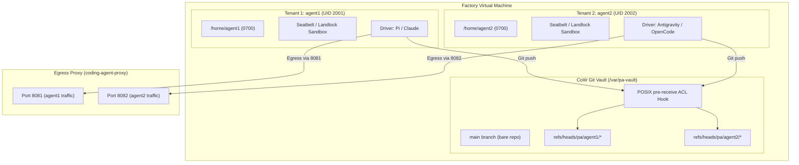
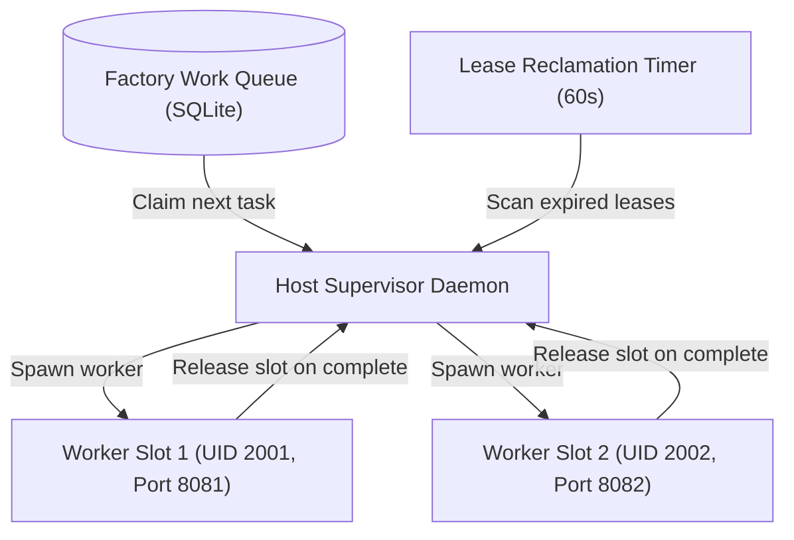

# Multi-Agent Architecture: PA-Container 2.0

PA-Container 2.0 provides native multi-tenant agent execution inside a shared Factory VM. Rather than running a single container per agent, the Factory VM provisions dedicated POSIX user accounts, independent kernel sandboxes, isolated Git branches, and distinct proxy listening ports for each agent.

---

## 1. Multi-Tenant Agent Security Model



### Core Tenancy Principles

- **POSIX User Separation:**
    - Every agent runs under a unique POSIX UID ($\text{UID} \ge 2001$, e.g., 2001 for `agent1`, 2002 for `agent2`).
    - Home directories are locked down (`0700`), preventing cross-agent filesystem inspection.
- **Kernel-Level Sandboxing:**
    - Linux: Landlock ABI v4+ restricts filesystem traversal and network syscalls; Bubblewrap isolates namespaces.
    - macOS: Apple Seatbelt (`.sb`) profiles enforce read-only system roots and Metal GPU acceleration access.
- **Git Branch Namespacing:**
    - Agent Git operations interact with the local `/var/pa-vault` bare repository.
    - Agents may only push to their assigned branch namespace: `refs/heads/pa/$AGENT_ID/*`.
    - Cross-agent overwrites or pushes to `main` are rejected by the pre-receive hook.
- **Port-Based Proxy Attribution:**
    - `agent1` traffic routes through port `8081`; `agent2` routes through port `8082`.
    - Outbound audit logs (`flows-agent1.jsonl`, `flows-agent2.jsonl`) maintain forensic isolation.

---

## 2. Supported Agent Drivers

| Agent Identifier | Driver Engine | Binary Name | Default Config Path |
| :--- | :--- | :--- | :--- |
| `pi` | Pi Coding Agent | `pi` | `/home/<agent>/.pi/` |
| `claude` | Anthropic Claude Code | `claude` | `/home/<agent>/.claude/` |
| `opencode` | OpenCode CLI | `opencode` | `/home/<agent>/.config/opencode/` |
| `antigravity` | Google Antigravity | `agy` | `/home/<agent>/.gemini/antigravity/` |

---

## 3. Configuring Agents in `factory.toml`

Agents are declared under the `[[agents]]` array in `factory.toml`:

```toml
[[agents]]
id = "lead-dev"
uid = 2001
driver = "claude"
capabilities = ["git", "source-control", "languages", "language-servers"]
allowlist = ["api.anthropic.com", "github.com", "registry.npmjs.org"]
tokens = ["ANTHROPIC_API_KEY", "GITHUB_TOKEN"]

[[agents]]
id = "security-auditor"
uid = 2002
driver = "antigravity"
capabilities = ["git", "reverse-engineering", "code-intelligence"]
allowlist = ["generativelanguage.googleapis.com"]
tokens = ["GEMINI_API_KEY"]
```

---

## 4. Specialized Agent Roles

PA-Container 2.0 introduces declarative role definitions (`[roles.*]`) in `factory.toml`. Roles bind agents to abstract capability interfaces, restricting or granting access to factory systems:

| Role Identifier | Description | Abstract Capabilities |
| :--- | :--- | :--- |
| `spec_author` | Drafts requirements, links OKRs, authors OpenFastTrace tags | `traceability:read`, `traceability:write`, `okr:read` |
| `design_engineer` | Authors and validates W3C DTCG tokens & component contracts | `design_system:read`, `design_system:write` |
| `telemetry_engineer` | Inspects execution traces, tunes OTLP exporters, monitors spans | `telemetry:read`, `telemetry:write` |
| `governance_officer` | Audits factory health, reviews WIP limits, sets KR budget ceilings | `governance:read`, `governance:write`, `storage:read` |
| `qa_platform_engineer` | Hardens tests across Web, iOS Simulator, and Android targets | `traceability:verify`, `design_system:verify` |
| `finops_analyst` | Monitors token consumption, analyzes cost per KR, optimizes models | `governance:read`, `storage:read`, `okr:read` |

### Declaring Roles in `factory.toml`

```toml
[roles.spec_author]
description = "Drafts functional requirements and validates OKR linkages"
capabilities = ["traceability:read", "traceability:write", "okr:read"]

[roles.design_engineer]
description = "Maintains W3C DTCG tokens and cross-platform contracts"
capabilities = ["design_system:read", "design_system:write"]

[[agents]]
id = "architect"
uid = 2001
driver = "claude"
role = "spec_author"
capabilities = ["git", "source-control"]
allowlist = ["api.anthropic.com"]
tokens = ["ANTHROPIC_API_KEY"]
```

---

## 5. Built-in Agent Skills

Agents in PA-Container 2.0 are equipped with provider-agnostic skills staged under `.pi/skills/` (and translated for Claude, OpenCode, and Antigravity drivers):

- **`traceability-driven-dev`:**
    - Teaches agents how to annotate specifications and code with OpenFastTrace tags (`req~`, `impl~`, `utest~`, `vtest~`).
    - Enforces test-first workflows and coverage verification before proposing code changes.
- **`design-system-dev`:**
    - Instructs agents on W3C DTCG token schema conventions, token alias resolution, and component contract authoring (`design/contracts/*.toml`).
    - Prevents hardcoding raw color literals (`no_hardcoded_color`) and instructs agents to verify across Web, iOS, and Android targets.
- **`closed-loop-governance`:**
    - Guides agents to inspect active WIP limits, query remaining KR budgets via `pa okr status`, and respect local model throttling policies.

---

## 6. Multi-Agent CLI Workflows

### Launching Agents

```bash
# Launch lead-dev with a task
./pa run --agent lead-dev --prompt "Refactor authentication flow"

# Launch security-auditor concurrently in the same VM
./pa run --agent security-auditor --prompt "Scan codebase for unsafe pointer usage"
```

### Inspecting Port Status

```bash
./pa proxy
```

### Reviewing Worktree Changes

Each agent's commits are reviewed independently without polluting the host's active working tree:

```bash
# Review changes from lead-dev in a local worktree
./pa review lead-dev --open

# Review changes from security-auditor
./pa review security-auditor --open
```

---

## 7. Cross-Agent Skill Compiler (`pa skills`)

PA-Container 2.0 includes an open-ended **Skill Compiler** that translates canonical capability skills (`.pi/skills/` and `pa_packages/**/skill/SKILL.md`) and Model Context Protocol (MCP) server bindings into agent-native instructions and configurations.

### 7.1 Compilation and Staging Workflows

To compile skills for a single agent driver or all agents without polluting the host Git repository:

```bash
# Dry-run compilation for Pi with role-scoped least privilege
pa skills compile --agent pi --role traceability_auditor --dry-run

# Compile and stage for all active agents into ephemeral staging root
pa skills compile --agent all --out .pa/staged-skills/

# Emit structured compilation results as JSON
pa skills compile --agent claude --json
```

### 7.2 Inspecting Registered Drivers

List all active emitters across built-in Rust emitters, declarative manifests, and external plugins:

```bash
pa skills drivers
```

### 7.3 Verifying Integrity & Merkle Roots

Validates skill YAML frontmatter, checks for missing references in `factory.toml`, and outputs the deterministic `skills_merkle_root`:

```bash
pa skills verify
```

### 7.4 Adding New Agents via Declarative Driver (`emitter.toml`)

New agents can be supported without recompiling `pa-core` by adding `pa_packages/agents/<agent_name>/emitter.toml`:

```toml
[driver]
id = "cursor"
description = "Cursor IDE Rules and MCP Driver"

[skills]
layout = "per_skill_file"
path_pattern = ".cursor/rules/{name}.mdc"
include_frontmatter = true

[mcp]
target_path = ".cursor/mcp.json"
format = "json"
schema_wrapper = "mcpServers"
```

### 7.5 Adding External Plugin Drivers (`custom_cmd`)

External tools can act as skill compilers by implementing the canonical JSON protocol:
- **Input (stdin):** `CompiledSkillBundle` JSON (`schema_version = 1`, `role`, `skills`, `mcp_servers`).
- **Output (stdout):** Array of `EmittedFile` JSON objects (`[{"path": "...", "content": "...", "executable": false}]`).
- Path-containment validation automatically rejects any emitted file attempting path traversal (`..` or root escaping).

---

## 8. Concurrent Host Supervisor (`pa supervisor`)

The Concurrent Host Supervisor daemon orchestrates asynchronous multi-agent execution inside the shared Factory VM. It automatically pulls work from the persistent work queue, provisions isolated tenant environments, enforces rolling concurrency limits, and reclaims dead or expired worker leases.

### 8.1 Architecture & Lease Management

The supervisor manages concurrency using dynamic slot allocations:
- **Tenant UID Allocation:** Assigns unique POSIX UIDs starting from `[supervisor].slot_uid_start` (default `2001`).
- **Proxy Port Allocation:** Dynamically maps dedicated proxy egress ports starting from `[supervisor].slot_proxy_port_start` (default `8081`).
- **Heartbeat & Lease Reclamation:** Each worker receives a lease with a configured time-to-live (`lease_ttl_sec`, e.g., 1800s). A periodic sweep (`reclaim_interval_sec`, default 60s) detects worker crashes, releases abandoned slots, and resets failed tasks for retry or escalation.



### 8.2 Supervisor CLI Subcommands

```bash
# Start supervisor in background daemon mode
pa supervisor start --daemon

# Start supervisor in foreground interactive mode with custom concurrency
pa supervisor start --foreground --concurrency 4

# Query running supervisor daemon status and active worker leases
pa supervisor status

# Gracefully stop the supervisor daemon (allows active leases to finish or reclaim)
pa supervisor stop
```

---

## 9. Factory Work Queue & Task Management (`pa task`)

PA-Container 2.0 provides an asynchronous, priority-ordered work queue backed by SQLite (`.pa/factory.db`). Tasks can be enqueued by CI triggers, human developers, or upstream autonomous processes.

### 9.1 Task Lifecycle & States

Tasks transition through explicit lifecycle states:
- `queued`: Waiting in queue, sorted by `priority ASC, created_at ASC`.
- `running`: Actively executing in an allocated worker slot.
- `awaiting_human`: Paused pending human review, clarification, or gate approval.
- `completed`: Successfully passed all quality gates, evals, and merged/pushed.
- `failed`: Terminated due to unrecoverable errors, gate failures, or exhausted retries.
- `cancelled`: Manually cancelled via CLI or API.

### 9.2 Task Management Subcommands

```bash
# Enqueue a new feature task with priority and initial model tier
pa task enqueue --role feature --req REQ-AUTH-01 --kr KR-AUTH-01 --priority 50 --tier local

# List queued and running tasks
pa task list

# Filter tasks by status (e.g., awaiting human review)
pa task list --status awaiting_human --limit 10

# Output task list as structured JSON for automation
pa task list --json

# Resume a task paused for human input
pa task resume task-20261124-001 --response "Proceed with JWT token authentication"

# Cancel a pending or runaway task
pa task cancel task-20261124-001
```

---

## 10. Autonomous Model Escalation Chain

PA-Container 2.0 implements closed-loop model routing and escalation, ensuring cost efficiency by default while dynamically escalating to more capable models when complexity demands it.

### 10.1 Escalation Tiers & Configuration

The model chain is declared under `[routing.escalation]` in `factory.toml`:

```toml
[routing.escalation]
enabled = true
min_first_pass_yield = 0.85
max_change_failure_rate = 0.10
min_eval_score = 0.75
tiers = ["local", "fast", "reasoning"]
```

The progression moves upwards along three tiers:
1. **`local`:** Low-latency, cost-free local models (e.g., Qwen 2.5 Coder 32B running on Apple Metal or Incus vGPU via `llama-server`).
2. **`fast`:** High-throughput frontier models for moderate complexity (e.g., Claude 3.5 Haiku, Gemini 2.0 Flash).
3. **`reasoning`:** Deep-thinking frontier models for complex multi-file architectural refactoring (e.g., Claude 3.5 Sonnet, o1/o3-mini).

### 10.2 Escalation Triggers

- **Proactive Promotion:**
    - Before task execution begins, `GovernanceEngine::resolve_initial_tier` checks historical rolling FPY and CFR for the role and Key Result.
    - If the rolling FPY falls below `min_first_pass_yield` (e.g., 0.85) or CFR exceeds `max_change_failure_rate` (e.g., 0.10), the task is proactively promoted from `local` to `fast` or `reasoning`.
- **Reactive Gate Failure Escalation:**
    - If a task fails automated quality gates (OpenFastTrace traceability, design token freshness/drift, cargo-audit SCA, or LLM eval rubrics), `GovernanceEngine::evaluate_escalation` triggers upward escalation.
    - Emits an OTLP child span `emit_escalation_span` attached to the root task trace.
    - Records the final model tier in commit Git trailers (`X-PA-Model-Tier: <tier>`).

---

## 11. Extensible Skill Emitter Drivers

The Skill Compiler supports five driver architectures in `crates/pa-core/src/skills/emitters.rs`:

- **`PiEmitter` (`driver = "pi"`):**
    - Emits per-skill markdown files to `.pi/skills/{name}/SKILL.md`.
    - Generates Model Context Protocol (MCP) tool configurations in `.pi/mcp.json`.
- **`ClaudeEmitter` (`driver = "claude"`):**
    - Generates centralized instructions in `CLAUDE.md`.
    - Emits individual tool skills into `.claude/skills/{name}/SKILL.md`.
    - Produces Claude Code MCP configurations in `.claude.json`.
- **`OpenCodeEmitter` (`driver = "opencode"`):**
    - Writes skill definitions to `.opencode/skills/`.
    - Writes tool configurations to `.config/opencode/opencode.json`.
- **`AntigravityEmitter` (`driver = "antigravity"`):**
    - Staged under `.gemini/antigravity/skills/{name}/SKILL.md`.
    - Emits lazy and eager MCP server registrations into `.gemini/antigravity/mcp/`.
- **`DeclarativeEmitter` (Custom Drivers via `emitter.toml`):**
    - Allows adding new IDE and agent drivers (Cursor, Windsurf, Roo, etc.) with zero Rust code changes.
    - Declarative path patterns (`{name}.md`, `{name}.mdc`) and configurable MCP schema wrappers.

