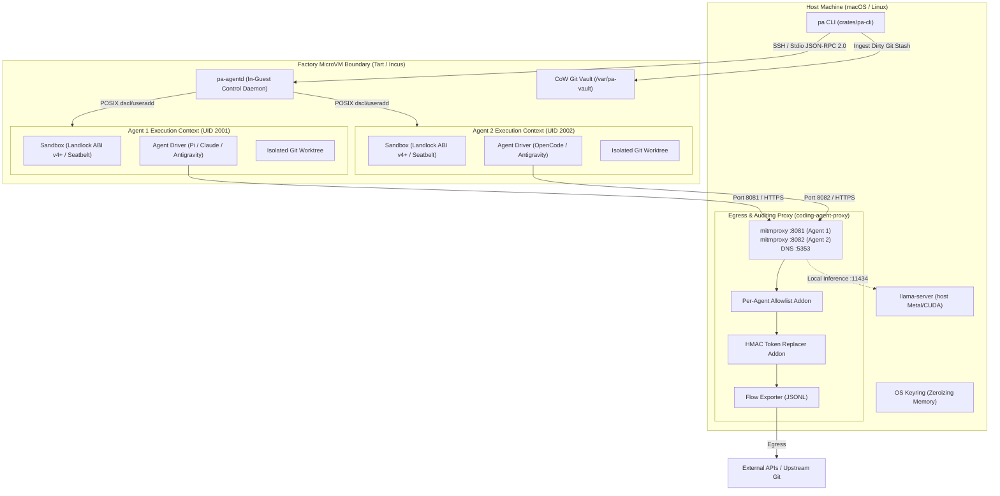

# Architecture: PA-Container 2.0 Software Factory

PA-Container 2.0 transforms personal agent development from single-agent container sandboxing into a multi-agent **Agentic Software Factory**. It provides hardware-grade virtualization boundaries, per-agent POSIX isolation, dynamic kernel sandboxing, and strict network auditing.

---

## 1. System Topology Overview

---

## 2. Core Architectural Layers

### Layer 1: Host Orchestration (`crates/pa-cli`)
- **Role:** Central developer-facing binary written in Rust using `clap`.
- **Key Responsibilities:**
    - Parses declarative configuration (`factory.toml`).
    - Synthesizes session nonces and derives HMAC-SHA256 placeholder tokens (`pa-tok-<agent_id>-<hash>`).
    - Stages capability skills across agent workspaces.
    - Synchronizes host dirty Git state into the in-guest Git Vault.
    - Manages lifecycle commands: `pa run`, `pa factory`, `pa review`, `pa proxy`, `pa logs`.

### Layer 2: MicroVM Hypervisor Isolation
- **Role:** Hard virtualization boundary preventing guest breakouts from reaching host memory or filesystem.
- **Backends:**
    - **macOS (`macos-tart`):** Automates Tart virtualization on Apple Silicon using official Apple IPSW restore images (`pa-factory-macos`). Network traffic routes over the `Softnet` bridge.
    - **Linux (`linux-incus`):** Automates Incus system containers and KVM virtual machines using Fedora 45 (`images:fedora/45/cloud`) with native network bridges.
- **Guest Performance & Storage Virtualization:**
    - **Headless Performance Tuning:** Automatically disables Spotlight indexing (`mdutil`), sleep timers (`systemsetup`), CrashReporter modal dialogs, and Gatekeeper quarantine prompts to prevent background CPU/disk contention.
    - **Dynamic Storage Resizing:** Guest daemons automatically invoke APFS container resizing (`diskutil apfs resizeContainer`) or filesystem expansion (`growpart` / `resize2fs`) on boot to claim expanded host block storage.
    - **Deterministic Toolchain Provisioning:** Configures non-interactive, zero-telemetry, and zero-auto-update settings for package managers (`HOMEBREW_NO_ANALYTICS=1`, `NONINTERACTIVE=1`).
    - **Metal Capability Virtualization & Ephemeral Host Lifecycle:** Overcomes Apple's virtual GPU feature level clamping (Apple Family 5, 32 KiB threadgroup memory) via declarative `[compute.metal]`. In `ephemeral` mode, `pa-core` temporarily unlocks the host hypervisor preference (`com.apple.gpusw.ParavirtualizedGraphics ForceUnrestrictedDeviceFeatureLevel`), reverting it cleanly on shutdown. In the guest, `pa-agentd` injects a process-scoped Objective-C interposer shim (`TartMetalCapabilities.dylib`) via `DYLD_INSERT_LIBRARIES` inside `sandbox-exec` exclusively for GPU-entitled tasks (`allow_gpu = true`), unlocking 64 KiB threadgroup memory and Apple Families 6 through 9 (M1-M4) for local LLM inference engines (MLX, `llama.cpp`) with zero persistent host pollution.

### Layer 3: In-Guest Daemon (`crates/pa-agentd`)
- **Role:** Statically compiled, single-binary daemon running inside the Factory VM.
- **Protocol:** Strongly typed JSON-RPC 2.0 over SSH stdio, requiring no exposed network ports.
- **Responsibilities:**
    - Provisions unprivileged agent users ($\text{UID} \ge 2001$) via POSIX commands (`dscl` on macOS, `useradd` on Linux).
    - Manages guest disk expansion (`resize_disk`) and sparse block compaction (`prune_caches`).
    - Enforces cgroups v2 resource quotas (memory, CPU, PID limits) on Linux.
    - Spawns and supervises sandboxed processes under dropped POSIX credentials.
    - Manages the iOS Simulator automation bridge via `ios-runnerd`.

### Layer 4: In-Guest Process Sandboxing
- **Role:** Second-line defense confining agent processes within their designated directories.
- **Implementations:**
    - **Linux (`crates/pa-landlock`):** Native Rust Landlock ABI v4+ ruleset restriction (`PR_SET_NO_NEW_PRIVS`, filesystem path access, TCP bind/connect filtering) combined with Bubblewrap (`bwrap`).
    - **macOS:** Dynamic Seatbelt (`.sb`) profile compilation executed via `sandbox-exec`. Enforces read-only system roots, isolated user homes, and hardware acceleration access to Apple Silicon Metal/ANE.

### Layer 5: CoW Git Vault (`/var/pa-vault`)
- **Role:** Atomic multi-tenant source code vault utilizing filesystem Copy-on-Write (CoW).
- **Branch Namespacing:**
    - Each agent is confined to its assigned Git branch: `refs/heads/pa/$AGENT_ID/*`.
    - Pure POSIX shell `pre-receive` hook evaluates ref pushes and aborts any cross-agent push attempts without requiring Python runtimes in the guest.

### Layer 6: Multi-Port Egress Proxy (`coding-agent-proxy`)
- **Role:** Network interception, auditing, and secret injection powered by `mitmproxy`.
- **Multi-Port Isolation:**
    - Each agent is assigned an independent proxy port (`8081`, `8082`, etc.).
    - Agents cannot inspect or spoof other agents' network traffic.
    - Host allowlists are enforced per port.
    - Placeholder tokens are verified against agent identity before real API credentials from the host keyring are injected into outbound headers.
