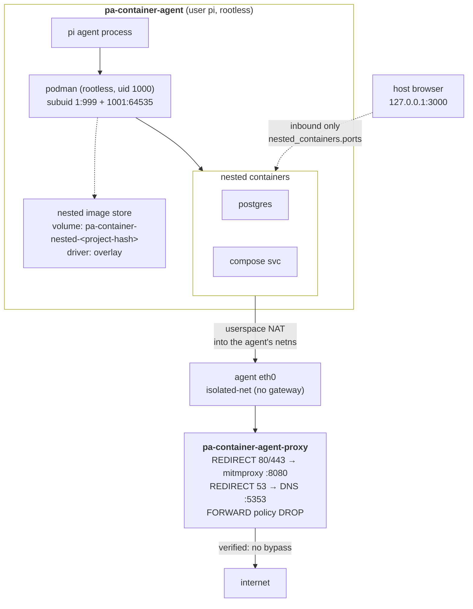

# Design details

<a name="proxy-egress-policy"></a>
## Proxy egress policy

mitmproxy intercepts only **HTTP, HTTPS, and DNS** (and applies the allowlist and token redaction). The system denies every other protocol by default. The proxy's `iptables` `FORWARD` chain policy is `DROP`. The system permits the `llama-server` API explicitly. The egress policy is **per-project**. To let the agent use another protocol (uninspected, plain NAT), opt it in under `egress.allow` in this workspace's `.pa-container/config.yaml`. The system seeds this file with deny-all on first run:

```yaml
# .pa-container/config.yaml
egress:
  allow:
    ssh: false            # TCP 22 (e.g. git over SSH)
    smtp: false           # TCP 25, 465, 587
    git: false            # TCP 9418 (git://)
    ntp: false            # UDP 123
    tcp_ports: []         # arbitrary extra TCP ports, e.g. [2222, 8443]
    udp_ports: []         # arbitrary extra UDP ports, e.g. [51820]
```

`run.py` reads this file. It passes the corresponding `PROXY_ALLOW_*` values into
that project's proxy container. The container's entrypoint opens the matching FORWARD rules.

> **Note:** protocols opted in here are forwarded **uninspected**. mitmproxy and
> the allowlist do not see them.

<a name="nested-containers"></a>
## Nested containers

The agent container is deliberately a dead end. None of the tooling to
start a container is normally present. Any task needing one (run Postgres for a
test, build and smoke-test an image, bring up a dev stack) fails outright.
Setting `nested_containers.enabled: true` in `.pa-container/config.yaml` gives the
agent its own **rootless podman inside its own container**.



Containers the agent starts are **children**, not siblings. They live in the agent's
mount and network namespaces. They bind-mount the agent's view of `/workspace`
directly and inherit its routing. Rootless podman NATs their traffic **into the
parent namespace's stack**. Nested traffic leaves from the agent's own
interface with the agent's source address. It follows the agent's routes. The
proxy's existing `-i eth1` REDIRECT rules match nested traffic with **no
proxy-side changes**. A nested container on the `--internal` network cannot
reach a raw IP at all. The kernel's routing layer in
the agent's netns returns `Network unreachable`.

Traffic in the other direction needs plumbing. A browser on the host opens a UI that a nested
container serves. A nested
container's own `-p` publishes into the *agent's* namespace. The agent container
publishes nothing to the host. `nested_containers.ports.publish` adds that outer
hop as `-p` flags on the agent container. You declare the ports in config. A container's published ports are fixed at start. This works inbound only. It adds no
egress. The proxy is still the only route out.

The system **never** mounts the host runtime socket. `/var/run/docker.sock` is a
full-privilege API to the host runtime. Mounting it would break this security model. Nesting adds no `--privileged`, no `seccomp=unconfined`, and no
`--userns` override. It does relax three things in the agent container: SELinux
*type* confinement (`label=disable`), podman's masked or read-only `/proc` paths
(`unmask=ALL`), and the capability set (`--cap-add SYS_ADMIN`, which is
namespaced, so container uid 0 is still an unprivileged host user). The last two
were hard requirements of the inner runtime. Nesting is opt-in and off by default. See
[Nested containers](configuration.md#nested-containers) for the configuration
surface and the full trade-off. See `docs/design/nested-containers.md` for the
design and its verification log.

## Agent Capability Packages (ACP) and build architecture

The platform compiles components and runtimes in isolated package images (`packages/<name>/` tagged `pa-container-pkg-<name>:local`) and projects them into the agent image:

| Component | Upstream / Distro | Built here | Why |
| --- | --- | --- | --- |
| Node.js | distro node | 26.6.0 (official tarball, or `NODE_SOURCE=build` compiles it) | Clean, reproducible Node.js runtime staged into `/usr/local` |
| CPython + `uv` + `podman-compose` | distro python | 3.15.2 (PGO) | The workspace targets 3.15. The **proxy image takes this tree too** (see below) |
| `podman` | Fedora 45 | 6.0.2 | Build tags, then version (see below) |
| `netavark`, `aardvark-dns` | distro version | 2.0.0 | podman 6.0.0 "must be used with Netavark and Aardvark v2.0.0" |

The base image for both agent and proxy is plain `registry.fedoraproject.org/fedora-minimal:45`. Required capability packages (`packages: [...]`) are assembled dynamically onto the base image using multi-stage copy layers.

The build-tag argument is the substantive one. podman's Makefile *derives* its
`BUILDTAGS` by probing the build host for installed `-dev` headers. The feature
set of a packaged binary is an accident of the packager's environment. You set them
explicitly to make it a decision. The decision for a rootless podman running
*inside* an unprivileged container differs from a distro's:

- **`seccomp`** — kept and load-bearing. Every nested container would run
  with unfiltered syscalls without it.
- **`containers_image_openpgp`** — Go-native OpenPGP instead of cgo `gpgme` plus the
  separate `podman-sequoia` library. This drops two runtime dependencies for signature
  policy this image does not use.
- **`exclude_graphdriver_btrfs`** — no btrfs driver and no `libbtrfs`. Nested storage
  is `overlay`, or `vfs` when overlay-on-overlay is unavailable.
- **no `systemd`** — a journald-capable podman also *defaults* to journald. There
  is no journal in the agent container. Without the tag the default is `k8s-file`.
- **no `libsubid`** — subuid and subgid are read from `/etc/subuid`. The image
  writes this file itself. This path works for nested user namespaces.

The result links only `libsqlite3`, `libseccomp`, `libc` and `libm`.

Each component builds in its **own stage** from a shared deps stage. The shipped
builder image is a `FROM scratch` that holds nothing but the four staged trees. Stage
independence matters most for Node. `NODE_SOURCE=build` takes ~65 minutes to compile Node.
Everything else takes a few minutes combined. A linear chain would make a podman bump
cost a full Node recompile.

Node is the one component with two modes. `NODE_SOURCE=prebuilt` (the default) stages
the official nodejs.org tarball. The `node:` base image installs this tarball too. This mode
is not a downgrade. It uses the same Node with the version pinned here instead of in a
tag. `NODE_SOURCE=build` compiles from source. This gives a trixie-native build rather than
the generic-glibc one. Node has no equivalent of podman's build tags. Both modes run the same parity
checks (`node`, `nodejs`, `npm`, `npx` present, version matches, full ICU, `Temporal`).

The builder stages each component at **its own root**: `/python/`,
`/node/`, `/podman/`, `/network/`. Every one of them already mirrors the layout it
lands in. A consumer copies the trees it wants straight onto `/`. The agent image
takes all four:

```dockerfile
COPY --from=pa-container-agent-builder:local /python/ /
COPY --from=pa-container-agent-builder:local /node/ /
COPY --from=pa-container-agent-builder:local /podman/ /
COPY --from=pa-container-agent-builder:local /network/ /
```

Keep separate roots instead of one merged `/out`. `COPY --from=<image>` can address
paths but not stages. Whatever this image's final stage lays down is all a consumer can
choose from. Keeping the components apart lets the **proxy image take
`/python/` alone**. It gets the same CPython and the same `uv` the agent runs. It gets no Node,
podman, or netavark in the TLS-terminating chokepoint. See
[Uniform Python across both images](#uniform-python-across-both-images).

Two further consequences worth knowing:

- **Project-specific image rebuilds never compile anything.** Before the split, a
  cache miss on the Python layer turned a workspace's rebuild into a ~10-minute PGO
  compile. Now it is a file copy.
- **A rebuilt builder invalidates project images**, the same way a rebuilt proxy
  does. `run.py` compares each project image's `pa-container.build.time` against
  both (see `_newest_shared_image_time()`).

### Uniform Python across both images

The proxy image used to be `python:<ver>-slim-trixie` with a `uv` binary pulled
separately from `ghcr.io/astral-sh/uv` by digest. That setup used a second interpreter and a
second `uv` pin next to the agent's. A different file bumped them by hand, and they drifted apart. The proxy could run a CPython patch release, an OpenSSL build, or a `uv` binary that the
agent had never seen. The one process that terminates TLS on every request the
agent makes needs a single answer to the question "which OpenSSL is that, exactly?"

Both images now take Python from the same build, and both refuse to start a build
without it:

- The proxy's base is plain `registry.fedoraproject.org/fedora-minimal:41` plus the runtime shared libraries the
  staged CPython's extension modules link against. A missing one causes a **build**
  failure. `python -c 'import bz2, ctypes, curses, lzma, readline, sqlite3, ssl,
  zlib'` runs right after the `COPY`. This catches the failure early instead of letting `import ssl` fail at
  interception time.
- `UV_PYTHON=/usr/local/bin/python3` and `UV_PYTHON_DOWNLOADS=never` make `uv sync`
  build the mitmproxy venv on the interpreter that you copied in. Without them a
  managed CPython download quietly reintroduces the drift.

Both images now carry the same CPython install. Every megabyte of it costs twice. The Python package build (`packages/python/package.yaml`) trims the staged tree of what neither image can
reach. It takes it from 474 MB to 175 MB:

| Removed | Size | Why it is dead here |
| --- | --- | --- |
| `lib/python3.15/test/` | 157 MB | CPython's own regression suite. Only `python -m test` reaches it |
| `libpython3.15.a` (two copies, not hardlinks) | 134 MB | Needed only to *embed* CPython in a C program. Building a native wheel links nothing. An extension resolves its Python symbols from the interpreter that loads it |
| `idlelib`, `tkinter`, `turtledemo` | 10 MB | `tk-dev` is not installed. `_tkinter` was never built. `import tkinter` already fails |

This is the trim the official `python:` images make as well, minus their `*.pyc`
deletion. `/usr/local` is not writable by the agent's `pi` user. A removed `.pyc`
would never be regenerated. Every import would re-parse source for the life of the
image.

What it gives up is **embedding CPython in a C/C++ program**. `python-config --ldflags
--embed` still advertises `-lpython3.15` (sysconfig reports what the build configured,
not what is on disk). An embed link fails at `cannot find -lpython3.15`. Plain
`--ldflags` (the extension-module case) does not name it and is unaffected.

There is no **shared** `libpython` here either, and never was. `./configure` runs
without `--enable-shared`. `Py_ENABLE_SHARED` is `0`. The build links
the interpreter core into the `python3.15` binary. Tools that require one could not work in this image before the trim and
cannot now. These tools include PyInstaller, Nuitka, and `dlopen`-based embedding. Restoring the static archive would not change that. Making them work needs an
`--enable-shared` rebuild. That costs every workload a slightly slower interpreter to
serve a case that neither shipped image has.

The claim that matters is **proven at build time**, not asserted. The claim is that dropping `libpython*.a` does not break `pip install` or
`uv sync` building a wheel from source in a workspace. The build compiles a small C extension against the staged headers. It imports it with the staged interpreter. It creates a `python -m venv` to confirm
`ensurepip` and the stdlib came through. A failure there fails the build.

Net effect on the images: proxy 417 MB → 509 MB, agent 1.6 GB → 1.3 GB, builder 790 MB → 486 MB. The proxy gained a full interpreter and lost the slim base.

**Build order is therefore a dependency, not a preference:** builder → proxy → agent.
`build.py` builds them in that order. The proxy `COPY`s from the builder and the
agent `COPY`s from both.

Sources are pinned by content, not by tag. The build checks each git tag against an
expected **commit** (tags are mutable; the peeled commit sha is the real pin). The build checks every
tarball (CPython, Node, Go, Rust, the Rust vendor trees) against a SHA-256.
`pa build` builds this image. Nothing else does.

**Every capability lives in `packages/<name>/package.yaml`** as an Agent Capability Package (ACP).
Manifests define versions, platform tarball URLs, SHA256 checksums, skill prompts, MCP servers, and egress policies.
Packages build into discrete capability images `pa-container-pkg-<name>:local` and are dynamically composed into agent images.
You can bump a package by editing its `package.yaml` or rebuild a specific package with:

```bash
pa build --packages <name>
```
