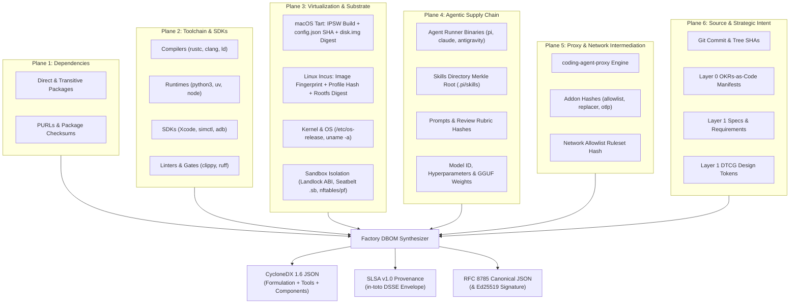

# Factory Digital Bill of Materials (Factory DBOM) & Attestations

PA-Container 2.0 introduces the **Factory Digital Bill of Materials (Factory DBOM)** capability. While traditional SBOM tools catalog only runtime and compile-time package dependencies, the Factory DBOM captures **all software components, tools, environments, configurations, versions, and cryptographic hashes** that lead to the creation of an end product from the software factory.

---

## 1. The 6 Provenance Planes

The Factory DBOM expands provenance into six orthogonal planes, providing end-to-end cryptographic genealogy from strategic intent to compiled binary:



### Plane Details

- **Plane 1: Product Dependencies Plane:**
    - Resolves `Cargo.lock`, `uv.lock`, and `package-lock.json`.
    - Captures standardized Package URLs (`purl`), versions, and registry integrity checksums.
- **Plane 2: Factory Toolchain & SDK Plane:**
    - Probes compiler binaries (`rustc -vV`, `clang --version`, `ld`).
    - Probes interpreter runtimes (`python3 --version`, `uv --version`, `node --version`).
    - Captures exact file paths and binary executable SHA256 hashes.
- **Plane 3: Virtualization, OS & MicroVM Substrate Plane:**
    - **macOS (Tart):** Captures Apple IPSW build number (`sw_vers -buildVersion`), Tart VM configuration hash (`config.json`), and base disk image digest (`disk.img`).
    - **Linux (Incus):** Captures Incus 64-character image fingerprint, instance profile hash, and base rootfs volume digest.
    - Captures guest OS distribution (`/etc/os-release`), kernel release (`uname -a`), and active sandbox profiles (Seatbelt / Landlock).
- **Plane 4: Agentic AI Supply Chain Plane:**
    - Captures runner executable hashes (`pi`, `claude-code`, `antigravity`).
    - Computes Merkle root hash of capability skills (`.pi/skills/`, `.gemini/skills/`).
    - Hashes task prompts, system prompts, and review rubrics.
    - Records model ID, inference mode (`cloud` vs. `local-llama`), and local GGUF weights hash.
- **Plane 5: Proxy & Network Intermediation Plane:**
    - Hashes `coding-agent-proxy` core and active addons (`allowlist.py`, `token_replacer.py`, `flow_exporter.py`, `otlp_exporter.py`).
    - Hashes active allowlist domain ruleset (`allowlist.toml`).
- **Plane 6: Source & Strategic Intent Plane:**
    - Git commit SHA, tree SHA, and dirty stash digest.
    - Content hashes of Layer 0 OKRs (`docs/okrs/*.toml`), Layer 1 specs (`docs/specs/*.md`), and DTCG design tokens (`design/tokens/tokens.json`).

---

## 2. Upfront Cryptographic Signing (SHA256 & Ed25519)

Every generated Factory BOM is signed upfront using both canonical hashing and public-key cryptography:

1. **RFC 8785 Canonicalization (JCS):** Normalizes the 6-plane data structure into deterministic canonical bytes.
2. **Canonical Digest:** Calculates `bom_digest = sha256:<hex_digest>`.
3. **Ed25519 Digital Signature:** Signs the canonical byte stream using the factory's private Ed25519 key (`ed25519-dalek`).
4. **in-toto DSSE Envelope:** Packages the attestation into a Dead Simple Signing Envelope (`application/vnd.in-toto+json`) with key ID and base64 signature.

### Managing Factory Signing Keys

Generate a new factory keypair:

```bash
pa bom keygen --output .pa/keys/factory_ed25519.key
```

Keys are resolved in the following order of precedence:
- Environment variable `PA_SIGNING_KEY` (32-byte hex or base64 seed).
- Host OS Keyring (`service = "pa-container"`, `username = "factory-signing-key"`).
- Private key file at `.pa/keys/factory_ed25519.key` (enforced mode `0600`).

---

## 3. Two-Tier Storage Architecture

```
.pa/
├── boms/
│   ├── <bom_id>.cdx.json        # Full CycloneDX 1.6 JSON
│   ├── <bom_id>.slsa.json       # Signed SLSA v1.0 in-toto DSSE Envelope
│   ├── <bom_id>.canonical.json  # Deterministic RFC 8785 Canonical JSON
│   └── <bom_id>.sig             # Raw Ed25519 signature
└── factory.db                   # SQLite WAL relational index
```

- **Filesystem Storage:** Full documents are stored under `.pa/boms/` with read-only permissions (`0444`).
- **Relational Index (`factory.db`):** Relational tables (`factory_boms`, `bom_artifacts`, `bom_materials`) index metadata, artifact digests, and component materials for fast joins with tasks and OKR spends.

---

## 4. CLI Usage & Commands

### Generating a Factory BOM

Generate, sign, and store a Factory DBOM for workspace artifacts:

```bash
pa bom generate --target pa-container --version 2.0.0
```

### Inspecting a BOM

Inspect a generated BOM or individual provenance planes:

```bash
pa bom inspect <bom-id>
pa bom inspect <bom-id> --plane toolchain
pa bom inspect <bom-id> --plane substrate
pa bom inspect <bom-id> --plane dependencies --json
```

### Verifying Policy & Cryptographic Signatures

Evaluate a BOM against declarative supply chain policies:

```bash
pa bom verify <bom-id> --policy bom-policy.toml
```

Example policy configuration (`bom-policy.toml`):

```toml
[bom.policy]
require_valid_signature = true
enforce_pinned_dependencies = true
require_clean_git_tree = true
allowed_rustc_versions = ["1.81", "1.82", "1.98"]
```

### Differential Analysis (Detecting Supply Chain Drift)

Compare two factory builds to identify why an artifact digest changed:

```bash
pa bom diff <bom-id-1> <bom-id-2>
```

### Exporting Standard Attestations

Export stored BOMs in CycloneDX 1.6 or SLSA v1.0 formats:

```bash
pa bom export <bom-id> --format cyclonedx --output bom.cdx.json
pa bom export <bom-id> --format slsa --output attestation.slsa.json
```

---

## 5. Git Commit Provenance Integration

During Gate 2 review sign-off (`pa feature review --approve`), the Factory BOM identifiers and signatures are stamped directly into Git commit trailers:

```
feat(auth): implement zero-trust oauth2 token cache

X-PA-Task-ID: 7f3b890a-1122-3344-5566-778899aabbcc
X-PA-Trace-ID: 4bf92f3577b34da6a3ce929d0e0e4736
X-PA-BOM-ID: bom-1795507656-654567fc
X-PA-BOM-Digest: sha256:7509eaae23e48dc07dd5a6974dcf6c1a647d2dba8c64da6c99eb36ea7aeac5a7
X-PA-BOM-Signature: SU5uyWfZULuAPowfoOuWVRP0XTFSADnwZ6LqAMPY+L8=...
X-PA-BOM-Key-ID: pa-factory-ed25519-494e6ec9
X-PA-Req-IDs: AUTH-01, AUTH-02
X-PA-KR-IDs: KR-AUTH-01
X-PA-Obj-ID: OBJ-2026-Q4-SEC
```
