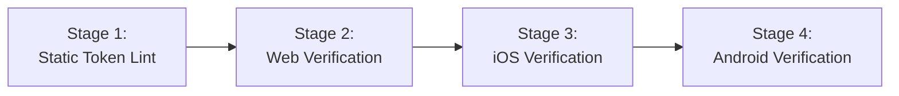

# Layer 1: Cross-Platform Design System Contracts

PA-Container 2.0 treats user interfaces as rigorous, verifiable contracts. Using the **W3C Design Tokens Community Group (DTCG)** standard and declarative component contracts, the platform automates UI compliance across **Web**, **iOS**, and **Android** platforms.

---

## 1. W3C DTCG Design Tokens

All design tokens (colors, dimensions, typography, spacing) are declared in `design/tokens/tokens.json` using the W3C DTCG format:

```json
{
  "color": {
    "primary": {
      "base": {
        "$value": "#2563eb",
        "$type": "color",
        "$description": "Primary brand color"
      },
      "hover": {
        "$value": "#1d4ed8",
        "$type": "color"
      }
    },
    "background": {
      "canvas": {
        "$value": "{color.primary.base}",
        "$type": "color"
      }
    }
  },
  "dimension": {
    "spacing": {
      "sm": {
        "$value": "8px",
        "$type": "dimension"
      },
      "md": {
        "$value": "16px",
        "$type": "dimension"
      }
    }
  }
}
```

### Key Features
- **Semantic Hierarchy:** Token groups categorize primitives (`color`, `dimension`, `font`).
- **Alias Resolution:** Tokens can reference other tokens using alias syntax (`{color.primary.base}`), evaluated deterministically by `pa-core`.
- **Git-First Source of Truth:** Autonomous agents read compiled token sets directly from Git without requiring access to external SaaS design platforms.

---

## 2. Component Contracts

Component contracts (`design/contracts/*.toml`) define how design tokens map to concrete UI elements and specify accessibility requirements:

```toml
[component]
name = "Button"
category = "primitives"
description = "Core interactive button component supporting primary, secondary, and destructive variants"

[tokens]
background_color = "color.primary.base"
text_color = "color.text.light"
padding_horizontal = "dimension.spacing.md"
padding_vertical = "dimension.spacing.sm"
border_radius = "dimension.radius.sm"

[states]
hover = { background_color = "color.primary.hover" }
disabled = { opacity = "0.5", cursor = "not-allowed" }

[accessibility]
min_touch_target_dp = 44
wcag_contrast_ratio = 4.5
screen_reader_label_required = true
```

---

## 3. Multi-Stage Design Gate

When running `pa design check` or executing a feature pipeline with UI modifications, `pa-core` executes a multi-stage design gate:



### Stage 1: Static Token & Primitive Lint
- Scans modified UI code (`.tsx`, `.jsx`, `.swift`, `.kt`) for anti-patterns.
- **Rule `no_hardcoded_color`:** Flags raw hex codes (`#2563eb`), `rgb(...)`, or `rgba(...)` in component implementations, requiring developers and agents to use DTCG design tokens.

### Stage 2: Web Verification
- Runs headless Chromium via Playwright.
- Validates DOM elements, component layouts, and runs automated `axe-core` accessibility audits for contrast and ARIA labels.

### Stage 3: iOS Verification
- Targets the Apple iOS Simulator on macOS Apple Silicon.
- Managed by `ios-runnerd` using `xcrun simctl`.
- Runs SwiftUI snapshot tests and checks Apple Accessibility (`XCAccessibilityElement`).

### Stage 4: Android Verification
- Targets the Android Emulator or headless Compose preview test runners (Paparazzi / Roborazzi).
- Managed via `adb`.
- Validates touch targets ($\ge 48\,\text{dp}$) and Espresso a11y checks.

---

## 4. Host Toolchain Policies & Parity

To prevent silent failures, PA-Container enforces strict host toolchain validation:

- **Missing Platform Policy (`on_missing_platform`):**
    - `"fail"` *(Strict / Default for specified platforms)*: If a platform is listed in `factory.toml` (e.g. `platforms = ["web", "ios"]`) but its host toolchain (`simctl`, `adb`) is missing, the gate **hard-fails** immediately with diagnostic instructions.
    - `"warn"`: Logs a warning and continues.
    - `"skip"`: Skips testing for the missing platform without failing.
- **Default Workstation Configuration:**
    - By default, `factory.toml` specifies `platforms = ["web"]`, ensuring developer workstations without Xcode or Android Studio pass the design gate smoothly.

---

## 5. Configuration in `factory.toml`

```toml
[design_system]
# Provider: "git_only", "penpot", "figma", or "none"
provider = "git_only"
tokens_path = "design/tokens/tokens.json"
contracts_path = "design/contracts"
platforms = ["web"]
on_missing_platform = "fail"

[design_system.web]
catalog = "storybook"
a11y_engine = "axe_core"
wcag_level = "AA"
visual_diff_tool = "playwright"
max_visual_diff_pct = 0.05
baseline_dir = "design/baselines"
on_missing_tool = "skip" # "skip" or "block"
```

---

## 6. CLI Inspection (`pa design`)

### Inspecting Tokens

```bash
# List all active W3C DTCG tokens
pa design tokens

# Filter tokens by type
pa design tokens --token-type color
pa design tokens --token-type dimension

# Export tokens as JSON for build scripts
pa design tokens --json
```

### Running Design System Verification

```bash
# Run all enabled platform checks and static token linters
pa design check

# Output structured compliance report as JSON
pa design check --json
```

Example output:
```text
Loaded 15 design tokens from design/tokens/tokens.json
Loaded 1 component contracts from design/contracts
Running static token lint...
  [OK] No hardcoded colors found in UI source files.
Running platform verification: [web]
  [OK] Web verification passed (Playwright & axe-core).
Design System Gate: PASSED (1 / 1 checks passed)
```
