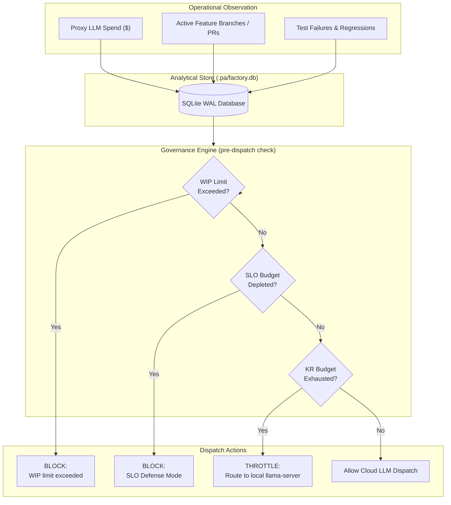

# Layer 3: Closed-Loop Factory Governance

PA-Container 2.0 closes the operational loop by joining proxy FinOps telemetry, Git review states, and OKR budgets inside an embedded analytical store. The **Closed-Loop Governance Engine** uses this data to enforce WIP limits, protect SLOs, and throttle runaway spending before tasks are dispatched.

---

## 1. The Closed-Loop Architecture



---

## 2. Governance Control Policies

Before any agent task or feature pipeline is launched (`pa run`, `pa feature run`), the Governance Engine evaluates three sequential guardrails:

### 1. Work-in-Progress (WIP) Limits (`max_wip_prs`)
- **Problem:** Autonomous agents can generate numerous half-completed features, overwhelming human reviewers and causing merge debt.
- **Enforcement:** The engine queries active feature branches and open review worktrees. If the count exceeds `max_wip_prs`, dispatch is **blocked** until existing features are reviewed and merged (`pa feature review <slug> --approve`).

### 2. SLO Defense Mode (`slo_defense_error_budget_min`)
- **Problem:** Rapid automated code generation during production incidents or test suite flakiness can worsen system instability.
- **Enforcement:** If recent test failure rates exceed allowable thresholds (e.g. error budget falls below `0.05`), the factory halts non-emergency feature generation and alerts the operator.

### 3. KR Budget Throttling (`budget_usd_per_kr`)
- **Problem:** Unconstrained agent loops can rapidly consume expensive commercial API quotas (Claude 3.5 Sonnet, GPT-4o).
- **Enforcement:** When cumulative LLM spend under a specific Key Result exceeds its `budget_usd` ceiling, the factory does not halt work. Instead, it dynamically **throttles** the task by re-routing inference to local, zero-cost models running on `llama-server` (e.g. `qwen2.5-coder-7b-instruct`).

---

## 3. Analytical Store (`factory.db`)

All factory events and metrics are persisted in a local, single-file SQLite database running in Write-Ahead Logging (WAL) mode at `.pa/factory.db`:

- **Zero-Dependency Durability:** Works offline on developer laptops without requiring an external database daemon.
- **Centralized Cloud Option:** On servers or CI, `factory.toml` can be configured to point to a centralized Postgres or ClickHouse database.
- **Tracked Metrics:** Task durations, prompt/completion token usage, dollar cost per agent and driver, test outcomes, DORA lead times, and KR spend.

---

## 4. Configuration in `factory.toml`

```toml
[storage]
# Provider: "sqlite", "postgres", or "clickhouse"
provider = "sqlite"
path = ".pa/factory.db"

[governance]
enabled = true
max_wip_prs = 5
slo_defense_error_budget_min = 0.05
budget_usd_per_kr = 100.0
fallback_model = "qwen2.5-coder-7b-instruct"
fallback_base_url = "http://127.0.0.1:11434/v1"
```

---

## 5. CLI Inspection (`pa telemetry report`)

Generate analytical reports summarizing factory performance, FinOps spend, and governance status:

```bash
# Print formatted terminal report
pa telemetry report

# Output JSON for reporting dashboards
pa telemetry report --format json
```

Example terminal output:
```text
=== Factory Analytics Report ===
Database: .pa/factory.db (SQLite WAL)

Tasks Executed: 42
Total Prompt Tokens: 1,248,320
Total Completion Tokens: 312,400
Total LLM Spend: $14.82 USD

Governance Status:
  Active WIP Features: 2 / 5 (OK)
  SLO Error Budget: 0.98 (OK)
  KR Budgets:
    - KR-SEC-01: $14.82 / $250.00 (Healthy)
    - KR-SEC-02: $0.00 / $150.00 (Healthy)
```
