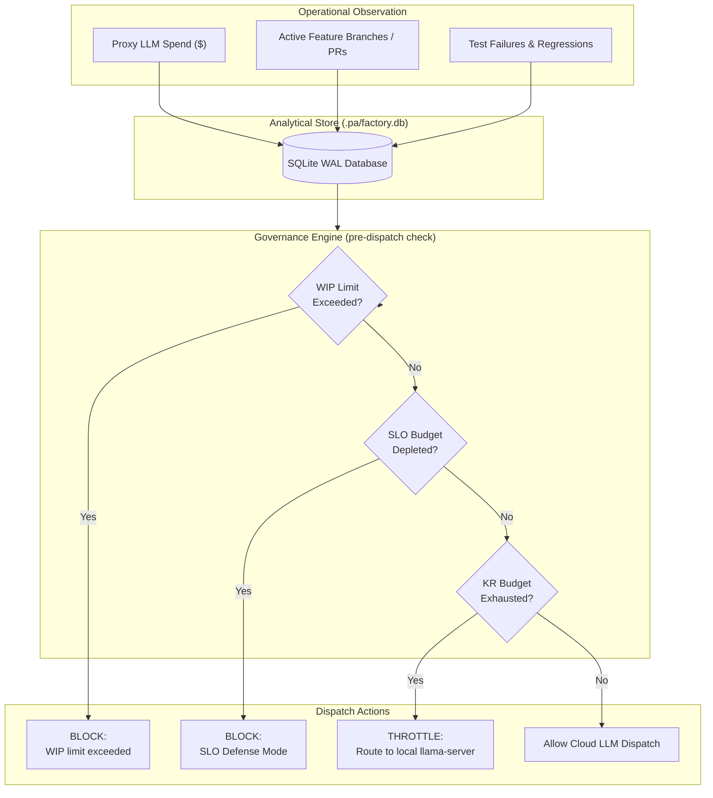

# Layer 3: Closed-Loop Factory Governance

PA-Container 2.0 closes the operational loop by joining proxy FinOps telemetry, Git review states, and OKR budgets inside an embedded analytical store. The **Closed-Loop Governance Engine** uses this data to enforce WIP limits, protect SLOs, and throttle runaway spending before tasks are dispatched.

---

## 1. The Closed-Loop Architecture



---

## 2. Governance Control Policies

Before any agent task or feature pipeline is launched (`pa run`, `pa feature run`), the Governance Engine evaluates three sequential guardrails:

### 1. Work-in-Progress (WIP) Limits (`max_wip_prs`)
- **Problem:** Autonomous agents can generate numerous half-completed features, overwhelming human reviewers and causing merge debt.
- **Enforcement:** The engine queries active feature branches and open review worktrees. If the count exceeds `max_wip_prs`, dispatch is **blocked** until existing features are reviewed and merged (`pa feature review <slug> --approve`).

### 2. SLO Defense Mode (`slo_defense_error_budget_min`, `on_slo_breach`)
- **Problem:** Rapid automated code generation during production incidents or test suite flakiness can worsen system instability.
- **Enforcement:** If recent test failure rates exceed allowable thresholds (e.g. error budget falls below `0.99` or Change Failure Rate exceeds 20%), the factory triggers **SLO Defense Mode**.
- **Role Gating & Hard-Block (`on_slo_breach = "block"`):**
    - Non-remediation feature dispatches (`role = "feature"`) are **hard-blocked** to protect production stability.
    - Remediation roles defined in `defense_mode_allowed_roles` (`["bugfix", "triage", "verifier"]`) remain permitted to resolve open issues.
    - Operators can bypass the guardrail with structured override auditing using `pa feature run <slug> --force` or `pa run --force`.

### 3. KR Budget Throttling (`budget_usd_per_kr`)
- **Problem:** Unconstrained agent loops can rapidly consume expensive commercial API quotas (Claude 3.5 Sonnet, GPT-4o).
- **Enforcement:** When cumulative LLM spend under a specific Key Result exceeds its `budget_usd` ceiling, the factory does not halt work. Instead, it dynamically **throttles** the task by re-routing inference to local, zero-cost models running on `llama-server` (e.g. `qwen2.5-coder-7b-instruct`).

### 4. Software Composition Analysis (SCA) Gate (`[governance.sca]`)
- **Problem:** Introducing third-party dependencies with known security vulnerabilities (CVEs) degrades supply chain security.
- **Enforcement:** Executes deterministic vulnerability scanning across project dependencies (`cargo-audit`, `trivy`, or custom command). Vulnerabilities meeting or exceeding `min_severity` (default `high` or `critical`) block feature verification and merge.

---

## 3. Analytical Store (`factory.db`)

All factory events and metrics are persisted in a local, single-file SQLite database running in Write-Ahead Logging (WAL) mode at `.pa/factory.db`:

- **Zero-Dependency Durability:** Works offline on developer laptops without requiring an external database daemon.
- **Centralized Cloud Option:** On servers or CI, `factory.toml` can be configured to point to a centralized Postgres or ClickHouse database.
- **Tracked Metrics:** Task durations, prompt/completion token usage, dollar cost per agent and driver, test outcomes, DORA lead times, and KR spend.

---

## 4. Configuration in `factory.toml`

```toml
[storage]
# Provider: "sqlite", "postgres", or "clickhouse"
provider = "sqlite"
path = ".pa/factory.db"

[governance]
max_wip_prs = 5
slo_defense_error_budget_min = 0.99
budget_usd_per_kr = 50.0
wip_mode = "combined" # "combined", "vcs_only", or "local_only"
on_slo_breach = "block" # "block" or "warn"
defense_mode_allowed_roles = ["bugfix", "triage", "verifier"]

[governance.sca]
enabled = true
provider = "both" # "cargo_audit", "trivy", "both", "custom_cmd", or "none"
min_severity = "high" # "low", "medium", "high", or "critical"
on_missing_tool = "skip" # "skip" or "block"
ignore_ids = []
```

---

## 5. CLI Inspection & Verification

### Inspecting Telemetry & Governance Status

```bash
# Print formatted terminal report
pa telemetry report

# Output JSON for reporting dashboards
pa telemetry report --json
```

### Running Software Composition Analysis (SCA)

```bash
# Verify dependency vulnerabilities
pa sca check

# Output structured SCA report as JSON
pa sca check --json
```

Example terminal output:
```text
=== Factory Analytics Report ===
Database: .pa/factory.db (SQLite WAL)

Tasks Executed: 42
Total Prompt Tokens: 1,248,320
Total Completion Tokens: 312,400
Total LLM Spend: $14.82 USD

Governance Status:
  Active WIP Features: 2 / 5 (OK)
  SLO Error Budget: 0.98 (OK)
  KR Budgets:
    - KR-SEC-01: $14.82 / $250.00 (Healthy)
    - KR-SEC-02: $0.00 / $150.00 (Healthy)
```

---

## 6. Upward Model Escalation & Concurrent Host Supervisor

PA-Container 2.0 features dynamic model escalation and an asynchronous multi-tenant Host Supervisor.

### Dynamic Upward Model Escalation

When agent tasks fail deterministic unit tests or quality gates (traceability, SCA, or design tokens), the factory automatically retries or escalates upward along a configured model chain:

```toml
[routing.escalation]
enabled = true
chain = ["local", "frontier", "frontier+verifier"]
max_retries_per_tier = 1
escalate_on = ["test_failure", "gate_failure"]
respect_kr_budget = true
min_first_pass_yield = 0.70
max_change_failure_rate = 0.25
min_sample_size = 5
```

- **FinOps Guardrail Precedence**: If the associated Key Result (`kr_id`) budget is exhausted, upward escalation halts immediately by default, transitioning the task to `awaiting_human` or failing unless `--force` is passed.
- **Proactive Tier Promotion**: When rolling historical metrics in `.pa/factory.db` show that a role on a local tier breaches FPY or CFR thresholds across `min_sample_size` tasks, the supervisor proactively promotes the task directly to the frontier tier prior to dispatch.

### Host Supervisor & Work Queue

The Host Supervisor manages concurrent worker slots (guest UIDs `2001..2016` and proxy ports `8081..8096`) backed by SQLite WAL:

```bash
# Start supervisor in foreground interactive mode
pa supervisor start --concurrency 4 --foreground

# Start supervisor in background daemon mode
pa supervisor start --daemon

# Inspect supervisor state, slot leases, and task queue
pa supervisor status

# Gracefully stop the supervisor daemon
pa supervisor stop
```

### Managing Tasks in the Work Queue

```bash
# Enqueue a task for asynchronous processing
pa task enqueue --role feature --req REQ-AUTH-01 --kr KR-AUTH-01 --priority 50 --tier local

# List queued and active tasks
pa task list

# Resume an awaiting_human task after operator review
pa task resume task-001 --response "Approved to proceed with OAuth2 migration"

# Cancel a task and release any held worker slot leases
pa task cancel task-001
```

- **WIP Reallocation**: When `max_wip_prs` is reached, idle supervisor slots shift to prioritize review and verification roles (`review_assist`, `verifier`, `traceability_auditor`) over new feature dispatches.
- **Mid-Turn HITL Pause**: Agents can request operator input via `agentintercom` (`hitl_pause` event). The supervisor marks the task `awaiting_human` and releases the compute slot lease while preserving the workspace until resumed.
