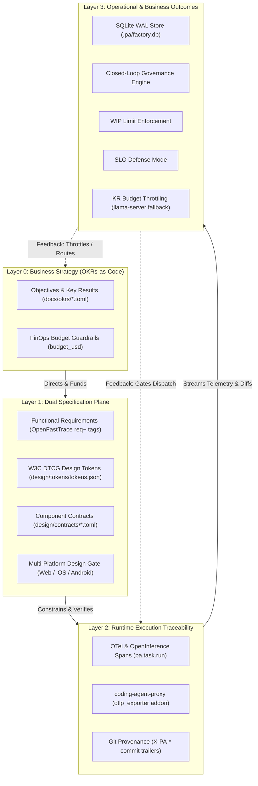

# 4-Layer Provenance & Closed-Loop Governance

PA-Container 2.0 evolves from an isolated agent execution sandbox into a closed-loop **Agentic Software Factory**. It links business strategy down to runtime code execution and closes the loop by feeding operational outcomes back into factory governance.

---

## 1. The 4-Layer Architecture Model

The provenance model bridges four distinct layers through shared correlation keys: `objective_id`, `kr_ids`, `req_ids`, `design_refs`, `task_id`, and `trace_id`.

---

## 2. Layer Breakdown

### Layer 0: Business Strategy (OKRs-as-Code)
- **Manifests:** Git-versioned TOML documents located in `docs/okrs/*.toml`.
- **Core Entities:** `[objective]` and `[[objective.key_results]]`.
- **FinOps Guardrails:** Each Key Result specifies an optional `budget_usd` ceiling.
- **Hierarchy Resolution:** Automatically associates technical requirements (`REQ-xxx`) with their parent Key Result (`KR-xxx`) and overarching Objective (`OBJ-xxx`).
- **Guide:** Learn more in [OKRs-as-Code (Layer 0)](okrs.md).

### Layer 1: Dual Specification Plane
- **Functional Requirements:**
    - Git-versioned requirements verified inside the sandbox via the OpenFastTrace scanner.
    - Tags embedded in specs and code (`req~<id>`, `impl~<id>`, `utest~<id>`, `vtest~<id>`).
    - Enforced via `pa traceability check`.
    - **Guide:** Learn more in [Specs & Traceability (Layer 1)](traceability.md).
- **Cross-Platform Design System:**
    - Git-versioned W3C Design Tokens Community Group (DTCG) tokens (`design/tokens/tokens.json`).
    - Component contracts (`design/contracts/*.toml`) defining cross-platform token bindings and states.
    - Automated verification across Web (Playwright/axe-core), iOS (`simctl`/`ios_runnerd`), and Android (`adb`/Compose).
    - Enforced via `pa design tokens` and `pa design check`.
    - **Guide:** Learn more in [Design System & Tokens (Layer 1)](design-system.md).

### Layer 2: Runtime Execution Traceability
- **OpenTelemetry & OpenInference Spans:**
    - Emitted natively from host orchestrator (`pa.task.run`) down to proxy-intercepted agent LLM calls (`gen_ai.chat`).
    - Exported to OTLP collectors (Arize Phoenix, Langfuse, or generic OTLP endpoints).
    - Automatic scrubbing of secrets and tokens before export.
- **Git Provenance Stamp:**
    - Gate 2 review sign-off stamps structured `X-PA-*` Git commit trailers onto merge commits.
    - Captures task ID, trace ID, requirements, KRs, objectives, and design references directly in the Git audit history.
- **Guide:** Learn more in [Runtime Telemetry & Git (Layer 2)](telemetry.md).

### Layer 3: Operational & Business Outcomes
- **Embedded Analytical Store:**
    - Local SQLite WAL database (`.pa/factory.db`) recording task durations, token usage, dollar cost, DORA metrics, test outcomes, and KR spend.
- **Closed-Loop Factory Governance:**
    - **WIP Limits (`max_wip_prs`):** Prevents task dispatch when in-flight PRs exceed capacity.
    - **SLO Defense Mode (`slo_defense_error_budget_min`):** Pauses non-critical feature runs when service error budgets are depleted.
    - **KR Budget Throttling (`budget_usd_per_kr`):** Automatically routes model calls to local offline `llama-server` instances when cloud spending limits are exceeded.
- **Guide:** Learn more in [Closed-Loop Governance (Layer 3)](governance.md).

---

## 3. Shared Correlation Keys

Every stage of the factory links to the same standardized correlation keys:

| Correlation Key | Format Example | Scope & Propagation |
| :--- | :--- | :--- |
| `objective_id` | `OBJ-2026-Q4-SEC` | Declared in `docs/okrs/*.toml`, stamped in Git trailers & OTel spans. |
| `kr_ids` | `["KR-AUTH-01"]` | Declared in `docs/okrs/*.toml`, linked to requirements, tracked in FinOps ledger. |
| `req_ids` | `["AUTH-01", "AUTH-02"]` | Defined in `docs/specs/`, referenced in code comments, checked by traceability gate. |
| `design_refs` | `["button.primary"]` | Defined in `design/contracts/`, checked by multi-platform design gate. |
| `task_id` | `task-1732130000-abcd` | Generated at task run start, propagates via `proxy-bindings.json` to proxy and spans. |
| `trace_id` | `4bf92f3577b34da6a3ce929d0e0e4736` | OTel root trace identifier passed into proxy headers and stamped in Git trailers. |
