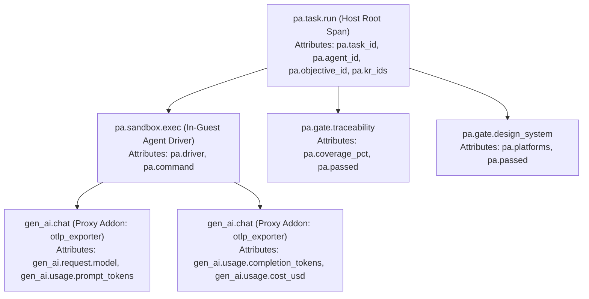

# Layer 2: Runtime Telemetry & Git Provenance

PA-Container 2.0 captures complete runtime execution traces by integrating native **OpenTelemetry (OTel)** spans, the **OpenInference GenAI** semantic convention, and cryptographic Git commit trailer stamping.

---

## 1. Span Hierarchy & OpenInference Model

Every task execution creates a structured trace tree that links host orchestration, sandbox daemon commands, LLM completions, and quality gates:



### Key Span Attributes

| Attribute Name | Semantic Convention | Description |
| :--- | :--- | :--- |
| `pa.task_id` | Internal | Unique session identifier for the task run. |
| `pa.objective_id` | Layer 0 Correlation | Linked Strategic Objective (`OBJ-xxx`). |
| `pa.kr_ids` | Layer 0 Correlation | Array of linked Key Results (`KR-xxx`). |
| `pa.requirements` | Layer 1 Correlation | Array of verified requirement tags. |
| `gen_ai.system` | OpenInference | Provider name (e.g. `anthropic`, `openai`, `gemini`, `local`). |
| `gen_ai.request.model` | OpenInference | Requested model identifier (e.g. `claude-3-5-sonnet-20241022`). |
| `gen_ai.usage.prompt_tokens` | GenAI Semantic Conv. | Total prompt tokens consumed. |
| `gen_ai.usage.completion_tokens` | GenAI Semantic Conv. | Total completion tokens generated. |
| `gen_ai.usage.cost_usd` | OpenInference | Calculated dollar cost for the request. |

---

## 2. Context Propagation & Zero-Leak Secret Scrubbing

### Atomic Context Propagation
1. When `pa run` or `pa feature run` begins, `pa-core` synthesizes a `TaskContext` containing the `task_id`, `trace_id`, `objective_id`, and `kr_ids`.
2. This is written atomically to `.pa/proxy-bindings.json` using a temporary file and atomic rename.
3. The `otlp_exporter` addon in `coding-agent-proxy` dynamically reads `proxy-bindings.json` and attaches the parent trace and correlation IDs to all intercepted LLM spans.

### Payload Secret Scrubbing
Before prompt or completion text is exported to any OTLP collector, the `otlp_exporter` scrubs sensitive data:
- Replaces authorization headers (`Bearer ...`, `Basic ...`).
- Masks API keys matching common vendor patterns (`sk-...`, `AIza...`, `ghp_...`).
- Eliminates potential credential exfiltration through telemetry backends.

---

## 3. Git Provenance: `X-PA-*` Commit Trailers

When a feature is verified and merged via Gate 2 (`pa feature review <slug> --approve`), `pa-core` automatically stamps structured RFC 5198 Git commit trailers into the merge commit:

```text
feat(auth): implement HMAC nonce verification

Verified implementation of agent request authentication with zero
token leaks through egress proxy.

X-PA-Task-Id: task-1732130000-abcd
X-PA-Trace-Id: 4bf92f3577b34da6a3ce929d0e0e4736
X-PA-Feature-Id: agent-auth-flow
X-PA-Requirements: AUTH-01, AUTH-02
X-PA-KRs: KR-SEC-01
X-PA-Objectives: OBJ-2026-Q4-SEC
X-PA-Design-Refs: button.primary
```

This embeds an immutable audit trail into Git history, enabling retrospective analysis without relying on external databases.

---

## 4. Local OTLP Backends (Docker Compose)

PA-Container provides ready-to-run Docker Compose stacks in `deploy/` for local desktop observability.

### Arize Phoenix (Recommended for Desktop)
Phoenix provides interactive LLM evaluation, span tracing, and token cost tracking:

```bash
# Start local Phoenix stack
docker compose -f deploy/phoenix/compose.yaml up -d

# Open Phoenix UI in your default browser
pa telemetry ui
```

Phoenix runs on `http://127.0.0.1:6006` by default.

### Langfuse
For teams standardizing on Langfuse:

```bash
# Start local Langfuse stack
docker compose -f deploy/langfuse/compose.yaml up -d
```

---

## 5. Configuration in `factory.toml`

```toml
[telemetry.otlp]
enabled = true
# Provider: "phoenix", "langfuse", "otlp_generic", or "none"
provider = "phoenix"
endpoint = "http://127.0.0.1:4318"
ui_endpoint = "http://127.0.0.1:6006"
service_name = "pa-factory"
sample_rate = 1.0
scrub_secrets = true
export_prompts = true
```

---

## 6. CLI Inspection (`pa telemetry`)

```bash
# Display active OTLP provider and endpoint health
pa telemetry status

# Open telemetry web dashboard
pa telemetry ui

# Inspect traces and events for a specific task
pa telemetry trace <task-id>

# Display aggregated analytical outcomes and FinOps spend
pa telemetry report

# Synchronize local database with telemetry events
pa telemetry sync
```
