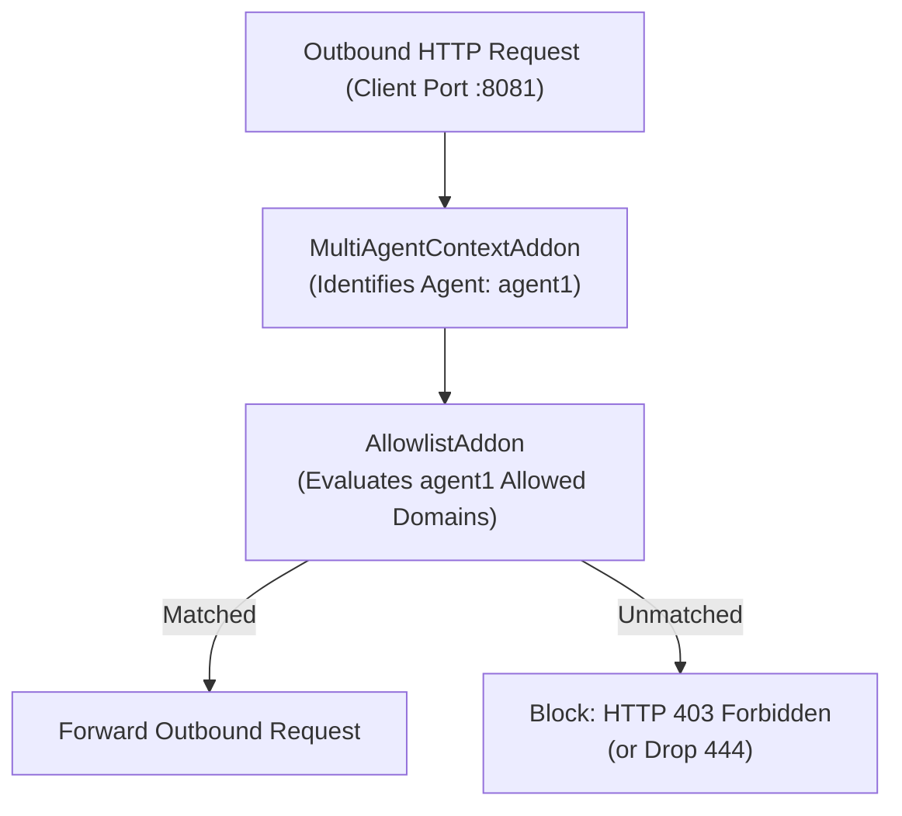

# Allowlist Addon

The `allowlist` addon filters HTTP and HTTPS traffic passing through the proxy. Only requests to allowlisted domains and IP address ranges pass through to the external network. The addon blocks all other connections (returning HTTP 403 by default, or closing the connection via status 444).

---

## 1. Multi-Agent Policy Architecture

In PA-Container 2.0, allowlists are configured declaratively and enforced per-agent:
- **Universal Defaults:** Global hostnames permitted across all agents declared in `factory.toml` (`[proxy.default_allowlist]`).
- **Per-Agent Allowlists:** Agent-specific hostnames declared in `factory.toml` (`[[agents]] allowlist = [...]`).
- **Capability Allowlists:** Domain requirements declared in attached capability manifests (`capability.toml`).



---

## 2. Configuration Model

Allowlists are declared directly in your project configuration without manual YAML editing:

### Declaring Allowlists in `factory.toml`

```toml
[proxy]
default_allowlist = ["github.com", "pypi.org"]

[[agents]]
id = "agent1"
driver = "pi"
capabilities = ["image-tools"]
allowlist = ["api.openai.com", "api.anthropic.com"]

[[agents]]
id = "agent2"
driver = "claude"
capabilities = ["reverse-engineering"]
allowlist = ["api.anthropic.com"]
```

### Capability Pack Allowlists (`capability.toml`)

When an agent mounts a capability pack, that pack's declared allowlist is automatically merged into the agent's active policy:

```toml
[capability]
name = "image-tools"

[proxy]
allowlist = ["api.stability.ai"]
```

---

## 3. Pattern Matching Rules

- **Exact Match:** `api.openai.com` matches only `api.openai.com`.
- **Wildcard Match:** `*.github.com` matches `api.github.com` and `raw.githubusercontent.com`.
- **IP CIDR Ranges:** `192.168.1.0/24` or `10.0.0.0/8`.
- **Localhost Bypass:** Loopback connections to local services (e.g. `127.0.0.1`, `llama-server`) are permitted by default.

---

## 4. Auditing Blocked Requests

When a request is blocked by the allowlist:
1. The proxy responds with HTTP `403 Forbidden` (`Blocked by PA-Container Allowlist`).
2. A visual indicator (🚫) is displayed in the `mitmweb` interface.
3. The event is recorded in the agent's forensic log:
   ```json
   {"agent_id": "agent1", "host": "evil.example.com", "status": 403, "decision": "blocked"}
   ```
