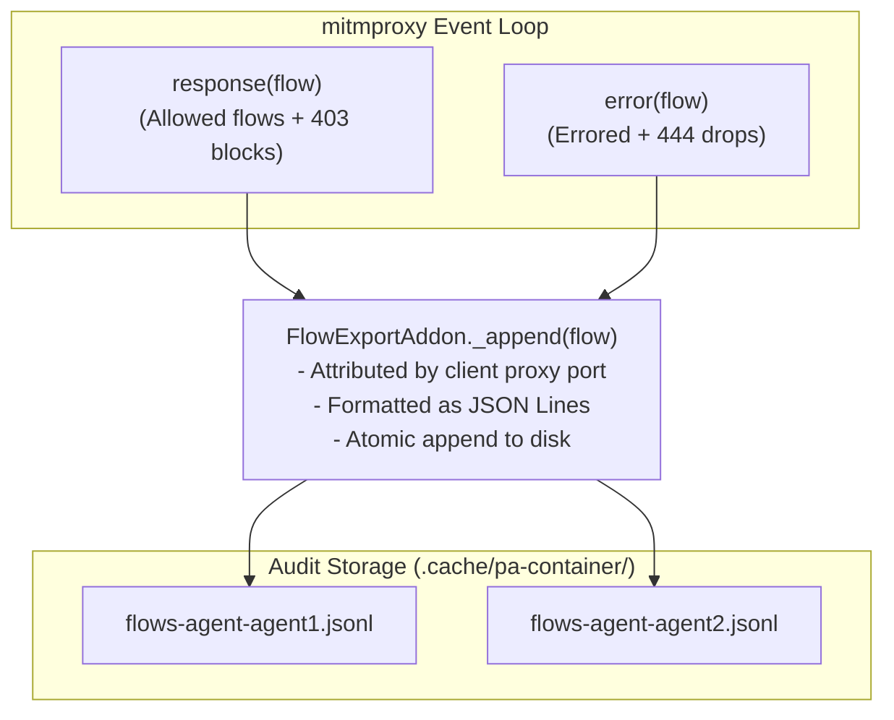

# Flow Export Addon

The `flow_export` addon records an audit trail of every HTTP, HTTPS, and DNS flow that passes through the proxy during an agent session. Each flow is recorded to a [JSON Lines](https://jsonlines.org/) file as it completes (`flows-agent-<agent_id>.jsonl`).

---

## 1. Incremental Append Architecture

Audit trails are appended incrementally as terminal hooks trigger (`response` or `error`), ensuring that audit records survive unexpected process aborts, container stops, or VM crashes.



---

## 2. Forensic JSONL Schema

Each line in the log file represents a complete transaction:

```json
{
  "timestamp": "2026-11-14T15:22:10.123Z",
  "agent_id": "agent1",
  "client_port": 8081,
  "method": "POST",
  "url": "https://api.openai.com/v1/chat/completions",
  "status_code": 200,
  "request_bytes": 1420,
  "response_bytes": 4890,
  "duration_ms": 645,
  "tokens_substituted": ["OPENAI_API_KEY"],
  "blocked": false
}
```

---

## 3. Reading Flow Logs

Inspect the audit logs directly using the unified `pa logs` CLI command:

```bash
# Print recent flows for agent1
./pa logs --agent agent1

# Limit to the last 20 entries
./pa logs --agent agent1 -n 20

# Stream live flow updates
./pa logs --agent agent1 --follow
```
