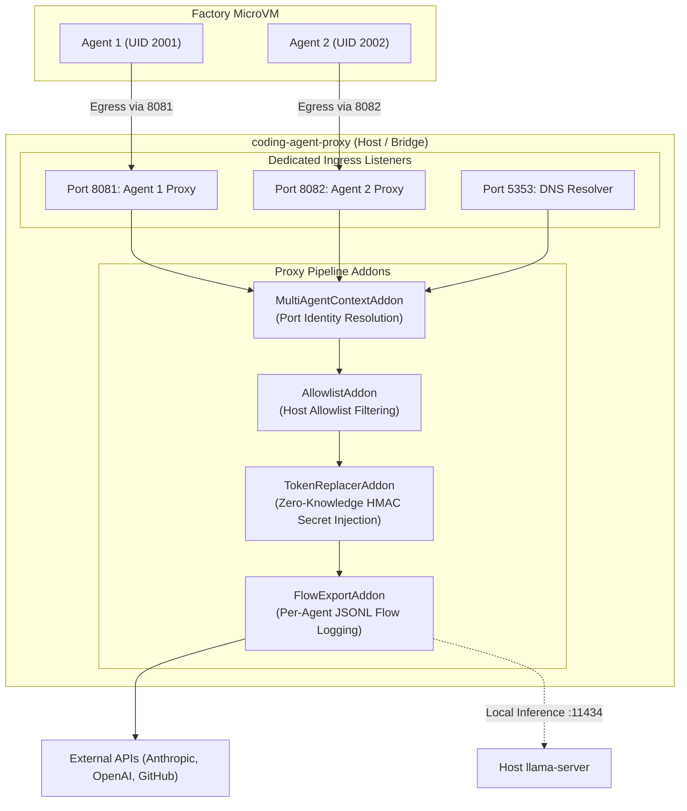

# PA-Container Egress Proxy

The PA-Container egress proxy (`coding-agent-proxy`) is a high-performance auditing, allowlisting, and credential-injection gateway built on [`mitmproxy`](https://mitmproxy.org). It inspects and polices all HTTP, HTTPS, and DNS traffic emitted by coding agents inside the Factory VM.

---

## 1. Multi-Agent Port Architecture



### Core Features

- **Port-Based Multi-Agent Isolation:**
    - Each agent is allocated an independent proxy listener port (`8081`, `8082`, etc.) and transparent DNAT port (`8091`, `8092`, etc.).
    - Traffic from one agent cannot be read, intercepted, or spoofed by another agent running on the same VM.
- **Strict Host Allowlisting:**
    - Only destinations declared in `factory.toml` and attached capability manifests (`capability.toml`) are reachable.
    - All other destinations fail closed with HTTP `403 Forbidden` (or TCP reset via status `444`).
- **Zero-Knowledge Secret Injection:**
    - Agent environments hold only session-scoped HMAC placeholder tokens (`pa-tok-<agent_id>-<hash>`).
    - The `token_replacer` addon verifies the placeholder against the agent's identity and substitutes real credentials from the host OS keyring before egress.
- **Forensic Flow Auditing:**
    - Outbound requests and responses are recorded incrementally in per-agent JSON Lines logs (`flows-agent-<id>.jsonl`).
    - Audit logs survive unexpected process crashes or ungraceful VM termination.

---

## 2. Proxy Addons Pipeline

The proxy runs four core addons loaded into `mitmproxy`:

| Addon | Role | Key Configuration |
| :--- | :--- | :--- |
| **`multi_agent_context`** | Resolves connecting client port to agent identity, UID, and policies. | Maps ingress port (e.g. `8081`) to `AgentPolicy`. |
| **`allowlist`** | Enforces host allowlists declared in `factory.toml` and `capability.toml`. | Returns `403 Forbidden` for unapproved hostnames. |
| **`token_replacer`** | Swaps HMAC placeholders with real API secrets for approved endpoints. | Scoped to matching destination hostnames. |
| **`flow_export`** | Records JSONL audit trails for each agent flow. | Writes to `.cache/pa-container/flows-agent-<id>.jsonl`. |

---

## 3. Inspecting Proxy State & Logs

### Viewing Live Routing Tables

Use the `pa proxy` command to inspect active ports, UIDs, and assigned allowlists:

```bash
# Print formatted proxy routing table
./pa proxy

# Output routing table as JSON
./pa proxy --json

# Open the mitmweb auditing UI in your browser
./pa proxy --open
```

### Reading Agent Flow Logs

Inspect the traffic generated by a specific agent:

```bash
# Display the last 50 network flows for agent1
./pa logs --agent agent1 -n 50

# Follow live flow stream
./pa logs --agent agent1 --follow
```
