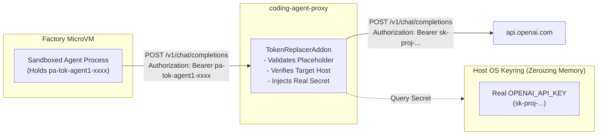

# Token Replacement Addon

The `token_replacer` addon prevents credential leakage by substituting placeholder tokens with real secrets only on outgoing network traffic to authorized hosts.

---

## 1. Zero-Knowledge Credential Model

Inside PA-Container 2.0, autonomous agents **never possess real API credentials or access tokens**.



### Key Principles

- **HMAC Placeholder Synthesis:**
    - The host CLI derives deterministic, session-scoped HMAC-SHA256 placeholder tokens:
      $$\text{Token} = \text{pa-tok-}\{\textit{agent\_id}\}\text{-}\operatorname{HMAC-SHA256}_{[:16]}(\text{session\_nonce}, \textit{agent\_id} : \textit{env\_var})$$
    - Placeholder tokens are unique per agent, session, and variable name.
- **Host-Scoped Injection:**
    - Real secrets are only injected if the outbound request destination matches the allowed hostnames configured for that secret.
    - If an agent sends an `OPENAI_API_KEY` placeholder to an unauthorized host (e.g. `evil.com` or `github.com`), the proxy rejects the request with HTTP `403 Token Security Violation`.
- **Zeroization & Memory Protection:**
    - Real credentials are read directly from the host OS keyring or encrypted environment and zeroized from memory immediately after use.

---

## 2. Declaring Tokens in Configuration

Tokens are declared in `factory.toml`:

```toml
[[agents]]
id = "agent1"
driver = "pi"
capabilities = ["image-tools"]
tokens = ["OPENAI_API_KEY", "ANTHROPIC_API_KEY"]
```

### Capability-Scoped Token Rules (`capability.toml`)

Capability packs scope token rules to specific target hosts:

```toml
[capability]
name = "source-control"

[[proxy.tokens]]
env_var = "GITHUB_TOKEN"
allowed_hosts = ["api.github.com", "github.com"]

[[proxy.tokens]]
env_var = "GITLAB_TOKEN"
allowed_hosts = ["gitlab.com"]
```

---

## 3. Supported Matchers & Protocols

- **HTTP Authorization Headers:** Bearer tokens (`Authorization: Bearer <placeholder>`).
- **Basic Authentication:** Base64-encoded `user:token` credentials in Git operations.
- **Request Bodies:** JSON bodies, form data, and multipart payloads.
- **Query Parameters:** URL query string parameters (e.g. `?api_key=<placeholder>`).
