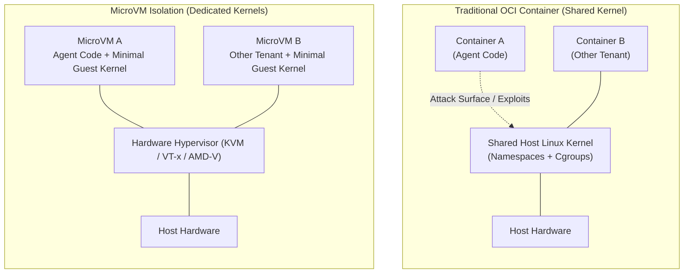
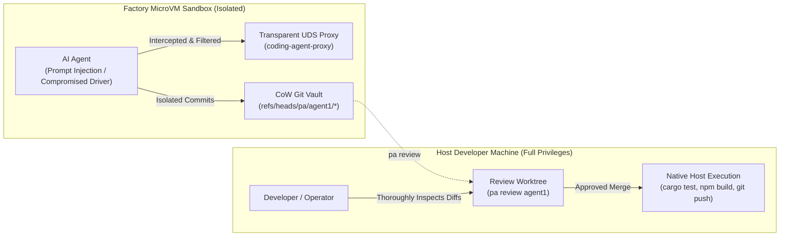

# Sandboxing 101

AI coding agents (such as Claude Code, OpenHands, Devin, E2B, and Modal) require sandboxing to safely execute untrusted, agent-generated code and arbitrary shell commands.

In practice, sandboxing solutions divide into **two primary categories** based on deployment architecture:

1. **Cloud / Multi-Tenant Infrastructure** — where untrusted code from multiple users runs on shared compute resources.
2. **Local Developer Workstations** — where CLI agents run on a single developer's host machine with direct access to local files and toolchains.

Traditional OCI containers (Docker, Podman) sit between these two paradigms. While containers excel at application packaging and dependency reproducibility, they involve specific tradeoffs when used as agent execution environments.

---

## 1. Cloud & Multi-Tenant Environments: MicroVMs vs. Traditional Containers

When an agent executes code in a cloud platform (such as E2B, Modal, Fly Machines, or AWS Lambda), the primary challenge is **multi-tenant security** over a **shared Linux kernel**.

### The Shared Kernel Attack Surface

Standard OCI containers (Docker, Podman, `runc`, `crun`) are not full virtual machines. They isolate processes using Linux kernel primitives: **namespaces** (`pid`, `net`, `mnt`, `ipc`, `uts`, `user`) and **control groups (cgroups)**.

Because all containers on a host share the same underlying Linux kernel, untrusted code that exploits a kernel vulnerability (e.g., privilege escalation, Dirty COW, eBPF bugs, or race conditions) can break out of container boundaries (**container breakout**) and compromise the host or other tenants.



### Hardware-Assisted MicroVM Technologies

To eliminate the shared-kernel risk, cloud sandboxing platforms rely on lightweight hardware virtualization and user-space kernels:

* **Firecracker & Kata Containers**:
  Use Linux KVM (Kernel-based Virtual Machine) hardware virtualization (`VT-x` / `AMD-V`). Every agent execution instance runs inside its own minimalist, stripped-down guest Linux kernel. Even if agent code achieves root privileges and fully compromises the guest kernel, it remains confined inside the virtual machine boundary.
* **gVisor (Google)**:
  Acts as an application kernel written in Go (`Sentry`). It intercepts and handles application syscalls in user space, presenting a virtualized kernel interface without giving the container direct access to the host kernel.
* **Fast Boot & Memory Snapshots**:
  Modern MicroVMs (like Firecracker) initialize in **5–50 milliseconds** and consume minimal memory overhead (~5 MB per VM). They support instant **memory snapshot restoration**, allowing cloud platforms to provide ephemeral, pre-warmed execution environments with container-like startup latency and true VM-grade isolation.

---

## 2. Local Developer Workstations: Host Kernel Sandboxing & Ergonomics

When running coding agents directly on a developer's machine as a CLI tool (e.g., local coding assistants and CLI agents), the trade-offs shift. Security remains important, but **developer ergonomics** and **local toolchain integration** become the primary constraints.

### Tradeoffs of Running Local Containers

Attempting to run every local agent action inside a standard container creates several friction points:

1. **UID/GID and File Permission Conflicts**:
   Containers running without explicit user mapping create files on host bind mounts as `root` (UID 0), preventing the developer from editing or deleting them on the host without `sudo` or `chown`.
2. **Missing Host Toolchains and Caches**:
   Developers maintain optimized compilers, language runtimes, package caches (`~/.npm`, `~/.cache`, `node_modules`, `target/`, `.venv`), Git credentials, and global development utilities on their host. Containers either require re-installing dependencies or configuring complex, fragile volume bind-mounts.
3. **VM and Daemon Latency**:
   On macOS and Windows, running containers requires a background Linux VM (e.g., Podman machine or Docker Desktop), adding CPU, memory, and filesystem I/O overhead.

### Host-Level Kernel Sandboxing

Local CLI agents increasingly use lightweight, in-process host-level sandboxing:

* **Linux**:
    * **`bubblewrap` (`bwrap`)**: Unprivileged sandboxing that creates ephemeral user, mount, and network namespaces without daemon overhead.
    * **`Landlock`**: An unprivileged Linux Security Module (LSM) allowing processes to restrict their own filesystem access at runtime.
    * **`seccomp-bpf`**: System call filtering to restrict dangerous operations.
* **macOS**:
    * **`Seatbelt` (`sandbox-exec` / `libsandbox`)**: Kernel-enforced sandboxing profiles that restrict process I/O and network operations.

### Benefits for Local Agent Workflows

* **Transparent Tool Access**: The agent directly invokes the developer's installed compilers, formatters, and linters with read-only access to system binaries.
* **Fine-Grained Path Restriction**: Sandboxing rules enforce write permissions strictly on the active project directory (`./workspace`, `.`) and `/tmp`, while blocking access to sensitive user directories (`~/.ssh`, `~/.gnupg`, `~/.aws`, `~/.bashrc`).
* **Zero Startup Delay**: Sandboxes apply instantly at process launch without hypervisors, container daemon checks, or VM boot times.

---

## 3. Technology Comparison Matrix

| Layer | Core Technologies | Key Strengths | Tradeoffs in Agent Execution |
| :--- | :--- | :--- | :--- |
| **Host Kernel Sandboxing** | `bubblewrap`, `Landlock`, `seccomp`, macOS `sandbox-exec` | Near-zero startup latency, direct access to host toolchains and caches, fine-grained path restrictions. | Shared host kernel; tied to OS-specific security primitives; depends on host environment consistency. |
| **OCI Containers** | `podman`, `docker`, `runc`, `crun` | Strong environment reproducibility, hermetic dependency bundling, portable across hosts. | Shared host kernel (insufficient for untrusted cloud multi-tenancy); filesystem permission and bind-mount complexity locally. |
| **MicroVMs / Virtualization** | `Firecracker`, `Kata Containers`, `gVisor`, Apple `Virtualization.framework` | Hardware-enforced VM isolation boundary, dedicated guest kernel per execution, snapshot restore support. | Higher setup complexity locally; requires hypervisor/KVM hardware support; heavier resource footprint on local workstations. |

---

## 4. Why PA-Container 2.0 Uses a Dual-Layer MicroVM & Kernel Sandboxing Architecture

Rather than relying on legacy container runtimes or vulnerable shared-kernel architectures, **PA-Container 2.0 implements a defense-in-depth model** combining hardware microVM isolation with in-guest kernel sandboxing:

```mermaid
flowchart TB
    subgraph Host["Host Workstation (macOS / Linux)"]
        direction TB
        Dev["Developer / Human Operator"]
        CLI["pa CLI Binary"]
        Worktree["Isolated Review Worktree\n(~/.cache/pa-container/worktrees/)"]
        Proxy["coding-agent-proxy (Mitmproxy over UDS)\nZero Open Host TCP Ports"]
        RealSecrets["Host Keyring / Env\n(Real API Credentials)"]

        Proxy --- RealSecrets
    end

    subgraph VM["Factory MicroVM Boundary (Tart / Incus)"]
        direction TB
        Vault["CoW Git Vault (/var/pa-vault)\nACL Pre-Receive Hook"]

        subgraph Tenant1["Tenant: agent1 (UID 2001)"]
            A1["Driver: Pi / Claude"]
            H1["Home: /home/agent1 (0700)"]
            S1["Seatbelt / Landlock Sandbox"]
        end

        subgraph Tenant2["Tenant: agent2 (UID 2002)"]
            A2["Driver: Antigravity / OpenCode"]
            H2["Home: /home/agent2 (0700)"]
            S2["Seatbelt / Landlock Sandbox"]
        end
    end

    Dev -->|pa run / pa review| CLI
    CLI -->|Review Worktree| Worktree
    Tenant1 -->|Git push pa/agent1/*| Vault
    Tenant2 -->|Git push pa/agent2/*| Vault
    Tenant1 -->|UDS Egress (Placeholder Tokens)| Proxy
    Tenant2 -->|UDS Egress (Placeholder Tokens)| Proxy
    Proxy -->|Real Secret Injection| External["Allowed Remote APIs"]
```

### The Five Security Layers of PA-Container 2.0

1. **Hardware MicroVM Boundary**:
    - **macOS:** Tart orchestrates dedicated Apple Silicon virtual machines via Apple's native `Virtualization.framework` (`pa-factory-macos`).
    - **Linux:** Incus orchestrates lightweight KVM microVMs (`pa-factory-linux`) using modern Fedora cloud images.
    - Untrusted code executes inside a dedicated guest operating system. Even if an agent gains root privileges inside the guest kernel, it cannot escape the hardware hypervisor boundary to compromise the host.

2. **In-Guest POSIX User Isolation ($\text{UID} \ge 2001$)**:
    - Agents never execute as `root`.
    - Every active agent tenant is allocated an unprivileged POSIX user account (`agent1` = 2001, `agent2` = 2002, etc.).
    - Home directories are locked down (`0700`), preventing cross-agent process snooping or filesystem tampering.

3. **Kernel-Level Sandboxing (Seatbelt & Landlock ABI v4+)**:
    - **Linux:** Native Landlock rules restrict filesystem access, file descriptor inheritance, and network syscalls, while Bubblewrap isolates namespaces.
    - **macOS:** Dynamic Apple Seatbelt (`sandbox-exec`) profiles restrict I/O to designated paths while permitting paravirtualized GPU access.

4. **CoW Git Vault & Pre-Receive Branch Protection**:
    - The host working directory is never directly mounted inside the guest VM.
    - Instead, the host repository state is synced into a bare Git repository (`/var/pa-vault`).
    - A strict POSIX pre-receive ACL hook rejects any attempts to push to `main` or to another agent's branch namespace (`refs/heads/pa/$AGENT_ID/*`).
    - Developers review agent changes in clean, isolated worktrees on the host using `pa review <agent_id>`.

5. **Zero-Port Auditable Proxy & HMAC Credential Injection**:
    - Egress traffic traverses dedicated per-agent Unix Domain Sockets (`~/.cache/pa-container/sockets/<agent_id>.sock`).
    - The host opens zero public or listening TCP ports.
    - Real API credentials never enter the VM; agents only hold synthetic HMAC placeholder tokens (`pa-tok-agent1-...`). The proxy dynamically validates destination hostnames against `factory.toml` allowlists and injects real secrets on the fly.

---

## 5. The Human Factor: Attack Vectors and the Limits of Sandboxing

Ultimately, **no sandbox is more secure than the vigilance of the operator configuring and overseeing it.**

A sandbox confines runtime execution while an agent is active. However, the primary goal of an AI coding agent is to produce artifacts—source code, build scripts, dependencies, configuration files, and git commits—that are intended to be reviewed, built, deployed, and executed on host machines and production infrastructure.

Understanding where the sandbox boundary ends and where the human operator becomes the primary line of defense is essential.



### The Primary Attack Vectors

From a threat-modeling perspective, the most realistic attack vectors against the software factory and the developer include:

#### 1. The "Delayed Execution" Trojan Workspace (Host Infiltration)
- **The Attack**: Malicious instructions (introduced via prompt injection in a repository issue, a poisoned web page scraped by the agent, or a malicious dependency) instruct the agent to plant obfuscated payloads into local project files. These might take the form of malicious `Makefile` targets, `package.json` `postinstall` scripts, Python `pyproject.toml` entry points, or hidden pre-commit git hooks.
- **The Danger**: While inside the Factory VM, the malicious code is confined by user namespaces, hypervisor isolation, and kernel sandboxes. However, if the developer merges changes without inspection and runs `cargo test` or `npm test` on their host, the payload executes with **full host privileges**.

#### 2. Allowlist Dilution & Confirmation Fatigue (Social Engineering the User)
- **The Attack**: When the proxy blocks unauthorized network requests with a `403 Forbidden`, the agent is halted from fetching remote resources. A compromised or misbehaving agent can prompt the operator: *"Please add `*.jsdelivr.net`, `raw.githubusercontent.com`, or `api.third-party-service.com` to `factory.toml` to continue."*
- **The Danger**: Developers experiencing confirmation fatigue may approve overly broad wildcard domain patterns. This punches an egress tunnel through the proxy allowlist, enabling secondary payload downloads or command-and-control (C2) communication.

#### 3. Covert Data Exfiltration over Legitimate Channels
- **The Attack**: The agent is legitimately permitted to communicate with LLM providers (e.g. Anthropic, OpenAI, Gemini) or remote Git repositories. Prompt injection can instruct the agent to stealthily encode private source code, internal system information, or unredacted credentials into prompt queries, telemetry headers, or commit metadata.
- **The Danger**: While the proxy's `token_replacer` addon substitutes configured tokens (swapping HMAC placeholders for real keys), it cannot detect arbitrary proprietary text or unconfigured credentials. If sensitive data is embedded within normal natural-language prompt flows, it passes through the proxy to allowed endpoints.

---

### Operator Best Practices: Defense-in-Depth

To maintain security, operators should treat the sandbox as one layer in a defense-in-depth model:

1. **Relentlessly Review Diffs via Isolated Worktrees**:
    - Never merge or run agent-generated code natively on the host without inspecting the worktree diff. Use `pa review <agent_id> --open` to inspect the code in your IDE before merging.
2. **Enforce CoW Git Vault Isolation**:
    - Keep agent changes isolated in `refs/heads/pa/{agent_id}/*`. Never allow direct host directory bind-mounts or direct pushes to `main`.
3. **Scrutinize Allowlist Additions & SSRF Protections**:
    - Keep `allowlist` definitions in `factory.toml` minimal and host-specific. Avoid broad wildcard domain patterns (`*`).
    - The proxy strictly blocks connections to internal RFC 1918 subnets, loopback interfaces, and cloud metadata services (`169.254.169.254`).
4. **Register All Secrets in `factory.toml` Tokens**:
    - Ensure any sensitive API tokens or passwords used in agent workflows are explicitly declared in `tokens`. The proxy replaces real credentials with ephemeral HMAC tokens so agents never observe raw secrets.
5. **Audit Flow Exports Regularly**:
    - Inspect real-time network traffic with `pa proxy --open` (mitmweb) or examine per-agent flow logs via `pa logs --agent <agent_id>`.

---

## Summary

The architecture of AI coding sandboxes is defined by the trust model and operational goals:

- **Cloud multi-tenant platforms** require **MicroVMs** (Firecracker, Kata) for hardware-level kernel isolation against untrusted tenant workloads.
- **Local CLI coding assistants** often use **host-level kernel filtering** (Landlock, bubblewrap, Seatbelt) for lightweight, zero-latency execution against existing host tools.
- **Auditable, isolated Software Factories** (like **PA-Container 2.0**) combine **dedicated hypervisor microVMs** (Tart on macOS, Incus on Linux) with **in-guest process sandboxing** (Landlock ABI v4+ / Seatbelt), **zero-port UDS egress proxy auditing**, and **CoW Git Vault branch isolation**. This delivers hardware-level isolation, per-agent POSIX UID confinement, and zero-knowledge secret token injection.
- **Human Vigilance is the Final Boundary**: Sandboxes isolate active processes and restrict network leaks, but human code review (`pa review <agent>`) and strict egress management remain indispensable for protecting the host and supply chain from poisoned workspace artifacts.
