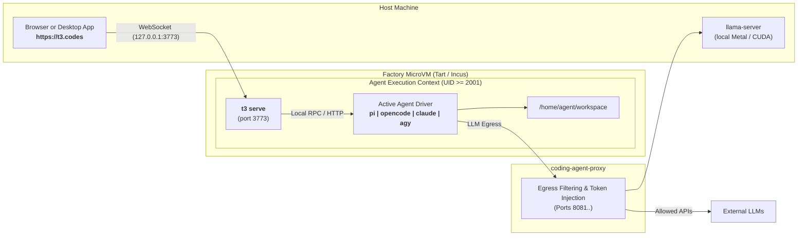

# T3 Code Integration

**T3 Code** ([t3.codes](https://t3.codes)) is an open-source, local-first control panel and graphical interface (desktop, web, and mobile) for AI coding agents. It provides a visual workspace with multi-threading, interactive diff reviews, branch management, and model reasoning visualizations.

T3 Code features native support for multiple coding agents:
- **Pi** (`@earendil-works/pi-coding-agent`), driven via its structured JSONL RPC interface.
- **OpenCode** (`opencode`), driven via its v2 HTTP/WebSocket server and OpenAPI interface.
- **Claude Code** (`@anthropic-ai/claude-code`), driven via the Claude Agent SDK.
- **Antigravity** (`agy`), driven via the Agent Client Protocol (ACP).

PA-Container 2.0 supports running T3 Code directly inside the Factory VM environment for any enabled agent. This enables the **https://t3.codes** web interface while retaining full network egress inspection, HMAC secret substitution, and kernel sandbox isolation.

---

## 1. Architecture Overview



### Key Architectural Principles

- **In-VM Execution**: The T3 Code server process (`t3 serve`) runs under the unprivileged agent user ($\text{UID} \ge 2001$) confined by kernel sandboxing (Landlock on Linux, Seatbelt on macOS).
- **Inbound Host Forwarding**: Host port `3773` binds to `127.0.0.1:3773` and routes to the Factory VM, allowing your host browser at `https://t3.codes` to establish a local WebSocket connection.
- **Proxy Egress & Token Replacement**: All outbound API calls from T3 Code or the agent traverse `coding-agent-proxy`. Unapproved network traffic is blocked, and placeholder tokens are replaced with real credentials on egress.
- **Git Vault Branch Isolation**: Agent changes made through T3 Code interact directly with the local CoW Git Vault (`/var/pa-vault`) on the agent's dedicated branch (`refs/heads/pa/$AGENT_ID/*`).

---

## 2. Quickstart

### Launching with T3 Mode

Run the agent in T3 server mode using the `pa run` command:

```bash
# Launch default agent with T3 server enabled
./pa run --agent agent1 --prompt "t3 serve"

# Launch specific agent driver (e.g. opencode or claude)
./pa run --agent agent2 --prompt "t3 serve"
```

The server outputs a pairing URL:
```text
==================================================================
  Starting T3 Code server inside PA-Container Factory VM...
  Web UI: https://t3.codes
==================================================================
Listening on http://0.0.0.0:3773
Pairing URL: http://localhost:3773/pair#token=abcdef123456...
```

### Connecting from Your Browser

1. Click the pairing link from your terminal or open [https://t3.codes](https://t3.codes).
2. T3 Code connects to your local instance via WebSocket (`ws://127.0.0.1:3773`).
3. Select any configured model from the model picker and begin prompt sessions.

---

## 3. Remote Access & Tunnel Integration

PA-Container supports secure tunneling via **Cloudflare** (`cloudflared`) and **Tailscale** (`tailscale serve`/`funnel`), allowing you to connect mobile devices or access your workspace remotely without port forwarding.

### Cloudflare Tunnel Integration

1. Store your Cloudflare tunnel token in the host OS keyring:
   ```bash
   uv run keyring set pa-container CLOUDFLARE_TUNNEL_TOKEN
   ```
2. Launch the tunnel alongside the agent:
   ```bash
   ./pa run --agent agent1 --extra-args "--tunnel cloudflare --tunnel-domain t3.yourdomain.com"
   ```
3. Connect your mobile browser or desktop app directly using the public hostname protected by Cloudflare Access SSO.

### Tailscale Serve & Funnel

If your host is connected to a Tailscale network (Tailnet), expose T3 Code securely within your tailnet:

```bash
./pa run --agent agent1 --extra-args "--tunnel tailscale"
```

---

## 4. Security Considerations

- **Strict Loopback Binding:** By default, port `3773` binds strictly to `127.0.0.1`. Remote machines on your local network cannot connect without explicit tunnel activation.
- **Uncompromised Sandbox Isolation:** Running T3 Code does not relax hypervisor or kernel sandbox confinement. The server runs under dropped POSIX credentials inside the microVM.
- **Multi-Port Proxy Attribution:** Outbound LLM requests from T3 Code traverse the agent's assigned proxy port (`8081`, `8082`, etc.), maintaining complete per-agent auditing and allowlist enforcement.
